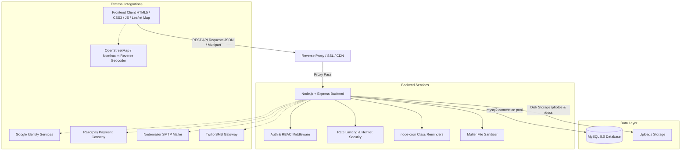

# 🎓 TutorLink — Home Tuition Marketplace

[](https://github.com/Ayush-T-iwar-i/tutorlink-website/actions)
[](LICENSE)
[](https://nodejs.org/)
[](https://www.mysql.com/)

**TutorLink** is a full-stack hyper-local home tuition platform that matches students with ID-verified tutors based on real distance, coordinates, and custom travel radiuses. It provides role-based workspaces for Students, Teachers, and Administrators with booking management, interactive schedule sessions, in-app chat, real-time notifications, reviews with teacher replies, and Razorpay online payments.

---

## 📑 Table of Contents

1. [Architecture & Data Flow](#-architecture--data-flow)
2. [Key Features](#-key-features)
3. [Technology Stack](#-technology-stack)
4. [Project Structure](#-project-structure)
5. [Local Development Setup](#-local-development-setup)
6. [Environment Variables](#-environment-variables)
7. [Database Schema & Migrations](#-database-schema--migrations)
8. [API Reference](#-api-reference)
9. [Automated Testing](#-automated-testing)
10. [Docker & Containerized Deployment](#-docker--containerized-deployment)
11. [Security Hardening & Best Practices](#-security-hardening--best-practices)
12. [Backup & Disaster Recovery Strategy](#-backup--disaster-recovery-strategy)
13. [Scalability Roadmap (Stages 1–4)](#-scalability-roadmap-stages-1-4)
14. [Future Features & AI Roadmap](#-future-features--ai-roadmap)

---

## 🏛 Architecture & Data Flow



### Core Business Workflows

1. **Student Discovery**: Student sets GPS location -> Map confirmation -> Nearby API evaluates clamped Haversine distance -> Student filters by subject, rating, and fee.
2. **Booking & Scheduling**: Student requests Demo or Recurring class -> Teacher accepts & sets fee -> System auto-generates concrete dated occurrences in `class_sessions` for up to 8 weeks.
3. **Class Reminders**: Background cron job checks upcoming sessions every 15 minutes and dispatches SMS/Email reminders 2 hours prior to class start.
4. **Payments**: Student initiates Razorpay checkout -> Server creates cryptographically signed order -> Student pays -> Server re-verifies HMAC-SHA256 signature timing-safely before marking booking as `paid`.
5. **Feedback Loop**: Once booking is marked `completed`, student can submit a 1–5 star rating with comments (editable within 24h) -> Teacher can post a public reply.

---

## ✨ Key Features

### 🎒 For Students
* **Distance-Matched Discovery**: Real-time radius queries matching tutors within 3, 5, 10, or 15 km.
* **Interactive Map Picker**: Leaflet + OpenStreetMap pin placement with GPS accuracy feedback.
* **Booking Manager**: Track demo and recurring classes, pay fees via Razorpay, and view class sessions.
* **Saved Tutors**: Bookmark favourite teachers to access their profiles anytime.
* **In-App Messaging & Reports**: Scoped real-time chat with tutor and moderation reporting.

### 🧑‍🏫 For Tutors
* **Complete Teaching Profile**: Showcase subjects, qualifications, experience, hourly fees, and bio.
* **Custom Availability Slots**: Declare available time slots for students to choose from.
* **Travel Radius & Verification**: Upload identity proof, address proof, and degrees for admin verification.
* **Earnings & Schedule Dashboard**: Live earnings analytics, payment status tracking, and 7-day schedule view.
* **Review Replies**: Respond directly to student feedback on public profiles.

### 🛡️ For Administrators
* **Verification Queue**: Review uploaded credentials and approve/reject tutor applications.
* **Platform Metrics**: Live statistics on students, tutors, bookings, and 14-day signup trends.
* **Reports Moderation**: Review and resolve user complaints with admin resolution notes.
* **Data Exports**: Download CSV records of all students and teachers.

---

## 🛠 Technology Stack

* **Backend**: Node.js, Express 4.x
* **Database**: MySQL 8.0 with `mysql2` connection pooling
* **Authentication**: JWT (`jsonwebtoken`), `bcryptjs` password hashing, Google OAuth (`google-auth-library`)
* **Security**: `helmet`, `express-rate-limit`, `cors`, `express-validator`, Timing-Safe HMAC verification
* **File Uploads**: `multer` with MIME verification and filename sanitization
* **Jobs & Communications**: `node-cron`, `nodemailer`, `twilio`, `razorpay`
* **Frontend**: Vanilla HTML5, Modern CSS3 ("Ink & Chalkboard" Design System), Vanilla ES6 JavaScript
* **Maps & Visualization**: Leaflet.js, OpenStreetMap, Chart.js
* **Testing & QA**: Jest, Supertest

---

## 📂 Project Structure

```text
tutorlink-website/
├── .github/
│   └── workflows/
│       └── ci.yml               # GitHub Actions Automated CI/CD Pipeline
├── backend/
│   ├── config/
│   │   ├── db.js                # MySQL pool connection
│   │   ├── email.js             # Nodemailer transporter & fallback logger
│   │   ├── email-templates.js   # HTML email templates
│   │   ├── razorpay.js          # Razorpay client instance
│   │   └── sms.js               # Twilio client instance
│   ├── database/
│   │   ├── schema.sql           # Unified, canonical database schema
│   │   ├── init-db.js           # Automated migration and DB setup script
│   │   └── migration_*.sql      # Incremental migration history (1–12)
│   ├── jobs/
│   │   └── reminders.js         # Automated 15-minute class reminder cron job
│   ├── middleware/
│   │   ├── auth.middleware.js   # JWT verification & RBAC guards
│   │   └── upload.middleware.js # Multer configuration for photos and docs
│   ├── routes/
│   │   ├── admin.routes.js      # Admin verification, stats & exports
│   │   ├── auth.routes.js       # Signup, login, lockout, password resets
│   │   ├── booking.routes.js    # Bookings, status transitions, earnings, schedules
│   │   ├── config.routes.js     # Public client configuration
│   │   ├── favorite.routes.js   # Student bookmarks
│   │   ├── message.routes.js    # In-app chat per booking
│   │   ├── notification.routes.js # User notifications
│   │   ├── payment.routes.js    # Razorpay order creation & signature verification
│   │   ├── report.routes.js     # Moderation complaints
│   │   ├── review.routes.js     # Ratings, reviews, and replies
│   │   ├── student.routes.js    # Student location & preferences
│   │   └── teacher.routes.js    # Browse, Haversine nearby, documents, profiles
│   ├── tests/
│   │   ├── auth.test.js         # Auth & lockout tests
│   │   ├── booking.test.js      # Booking lifecycle tests
│   │   ├── payment.test.js      # Razorpay & signature verification tests
│   │   ├── report.test.js       # Moderation report tests
│   │   ├── review.test.js       # Review & 24h rule tests
│   │   ├── security.test.js     # IDOR & SQL injection safety tests
│   │   └── teacher.test.js      # Discovery & distance calculation tests
│   ├── .env.example             # Configuration template
│   ├── package.json             # NPM package manifest
│   └── server.js                # Express application entrypoint
├── frontend/
│   ├── css/
│   │   └── style.css            # Unified Design System
│   ├── js/
│   │   ├── api.js               # Unified API client & session manager
│   │   └── google-auth.js       # Google Sign-In helper
│   ├── index.html               # Landing page
│   ├── teachers.html            # Public teacher directory
│   ├── teacher-profile-view.html # Public teacher profile & booking modal
│   ├── student-dashboard.html   # Student dashboard & map discovery
│   ├── teacher-dashboard.html   # Teacher dashboard & bookings
│   ├── admin-dashboard.html     # Admin verification queue
│   ├── login.html               # User login
│   ├── signup.html              # Multi-role registration
│   ├── student-complete-profile.html # Student profile setup
│   ├── teacher-complete-profile.html # Teacher profile & verification upload
│   ├── account-settings.html    # Password changes & account details
│   ├── forgot-password.html     # Password recovery request
│   ├── reset-password.html      # Password reset confirmation
│   ├── 404.html                 # 404 Not Found page
│   ├── privacy.html             # Privacy policy
│   ├── terms.html               # Terms of service
│   ├── robots.txt               # SEO crawler directives
│   └── sitemap.xml              # XML search engine sitemap
├── Dockerfile                   # Multi-stage production container build
├── docker-compose.yml           # App + MySQL production stack
└── README.md                    # Project documentation hub
```

---

## 🚀 Local Development Setup

### Prerequisites
* **Node.js**: v18.0.0 or higher
* **MySQL**: v8.0 or higher (or XAMPP / MariaDB)

### Step-by-Step Installation

1. **Clone the Repository**:
   ```bash
   git clone https://github.com/Ayush-T-iwar-i/tutorlink-website.git
   cd tutorlink-website
   ```

2. **Configure Environment Variables**:
   ```bash
   cp backend/.env.example backend/.env
   ```
   Open `backend/.env` and update `DB_HOST`, `DB_USER`, `DB_PASSWORD`, `DB_NAME`, and `JWT_SECRET`.

3. **Install Dependencies**:
   ```bash
   cd backend
   npm install
   ```

4. **Initialize Database Schema**:
   ```bash
   npm run db:init
   ```
   *Alternatively, run the SQL script in `backend/database/schema.sql` directly inside your MySQL client.*

5. **Start the Development Server**:
   ```bash
   npm run dev
   ```

6. **Access the Application**:
   Open [http://localhost:5000](http://localhost:5000) in your browser.

---

## 🔐 Environment Variables

| Variable | Description | Default / Example |
| :--- | :--- | :--- |
| `PORT` | HTTP server port | `5000` |
| `NODE_ENV` | Environment mode (`development`, `production`, `test`) | `development` |
| `FRONTEND_URL` | Base public URL for emails and links | `http://localhost:5000` |
| `ALLOWED_ORIGIN` | Allowed CORS origins (`*` for local dev) | `*` |
| `DB_HOST` | MySQL hostname | `localhost` |
| `DB_USER` | MySQL username | `root` |
| `DB_PASSWORD` | MySQL password | *(blank)* |
| `DB_NAME` | MySQL database name | `tutorlink` |
| `JWT_SECRET` | 32+ byte cryptographic secret for token signing | *(required)* |
| `DEFAULT_RADIUS_KM` | Default tutor search radius in kilometres | `5` |
| `GOOGLE_CLIENT_ID` | Google OAuth Web Client ID | *(optional)* |
| `SMTP_HOST` | SMTP server hostname | `smtp.gmail.com` |
| `SMTP_PORT` | SMTP port (`587` for TLS, `465` for SSL) | `587` |
| `SMTP_USER` | SMTP username / email address | *(optional)* |
| `SMTP_PASS` | SMTP application password | *(optional)* |
| `TWILIO_ACCOUNT_SID` | Twilio Account SID | *(optional)* |
| `TWILIO_AUTH_TOKEN` | Twilio Auth Token | *(optional)* |
| `TWILIO_PHONE_NUMBER` | Twilio Sender Phone Number (E.164 format) | *(optional)* |
| `RAZORPAY_KEY_ID` | Razorpay API Key ID | *(optional)* |
| `RAZORPAY_KEY_SECRET` | Razorpay API Key Secret | *(optional)* |

---

## 🧪 Automated Testing

TutorLink includes an extensive automated test suite built with **Jest** and **Supertest** covering authentication, rate limiting, IDOR prevention, SQL injection safety, nearby distance queries, review restrictions, and payment HMAC verification.

### Running Tests

```bash
cd backend
npm test
```

### Running Tests with Code Coverage

```bash
cd backend
npm run test:coverage
```

---

## 🐳 Docker & Containerized Deployment

TutorLink comes pre-configured with a production-grade multi-stage `Dockerfile` and `docker-compose.yml`.

### Quickstart with Docker Compose

```bash
docker-compose up -d --build
```

This starts:
1. **`tutorlink-mysql`**: MySQL 8.0 container with persistent data volume and automated schema initialization.
2. **`tutorlink-app`**: Node.js container running as a non-privileged user, health-checked via `/health`.

Verify stack status:
```bash
docker-compose ps
```

---

## 🔒 Security Hardening & Best Practices

1. **Brute-Force Account Lockout**: Accounts are locked for 15 minutes after 5 consecutive failed login attempts (`failed_login_attempts` & `locked_until`).
2. **Timing-Safe Cryptography**: Razorpay HMAC payment signatures use `crypto.timingSafeEqual` to eliminate timing side-channel attacks.
3. **IDOR & Role-Based Authorization**: Every resource route checks ownership against token identity (`req.user.id`) and role restrictions.
4. **Spatial Query Clamping**: Haversine distance calculations are bounded with `LEAST(1.0, GREATEST(-1.0, ...))` to prevent `ACOS(>1)` NaN dropouts.
5. **Sanitized Uploads & Storage**: Document uploads enforce strict MIME type checking (`image/jpeg`, `image/png`, `image/webp`, `application/pdf`), sanitized extensions, and 5MB size limits. Identity documents are stored privately behind authentication.
6. **XSS & SQL Injection Protection**: Parameterized queries across all database operations and `escapeHtml` utility on the frontend for rendering user-supplied strings.

---

## 💾 Backup & Disaster Recovery Strategy

### Automated Database Backup Script

Create a cron task on your Linux server:
```bash
# Backup every day at 02:00 AM
0 2 * * * mysqldump -u tutorlink_user -p'tutorlink_secure_password' tutorlink | gzip > /var/backups/tutorlink_$(date +\%Y\%m\%d_\%H\%M\%S).sql.gz
```

### Restore Procedure

```bash
gunzip < /var/backups/tutorlink_20260828_020000.sql.gz | mysql -u tutorlink_user -p'tutorlink_secure_password' tutorlink
```

---

## 📈 Scalability Roadmap (Stages 1–4)

```text
STAGE 1: Single VPS / Container Stack (0 - 10,000 Users)
├── Nginx (Reverse Proxy + SSL Termination)
├── Single Node.js Express Instance
└── MySQL 8.0 with InnoDB Buffer Pool Tuning

STAGE 2: Growth & Media Decoupling (10,000 - 100,000 Users)
├── Cloudflare CDN for static frontend assets & profile photos
├── AWS S3 / Cloudinary for document & photo storage
├── Redis cache for search results & session store
└── Managed Database (AWS RDS / Railway MySQL) with automated daily snapshots

STAGE 3: High Concurrency Multi-Instance (100,000 - 1,000,000 Users)
├── Load Balancer (AWS ALB / Nginx cluster)
├── Auto-scaling Node.js backend instances (Docker / ECS / Kubernetes)
├── Redis Pub/Sub for WebSockets & in-app chat
└── MySQL Read Replicas for search & read-heavy queries

STAGE 4: Enterprise Scale (1,000,000+ Users)
├── Spatial search offloaded to Elasticsearch / MySQL Spatial GIS with R-tree indexes
├── Message queue (RabbitMQ / BullMQ) for asynchronous email, SMS, and notifications
└── Dedicated microservices for Payments, Video Classrooms, and AI Recommendations
```

---

## 🔮 Future Features & AI Roadmap

1. **AI Tutor-Student Matchmaking**: Embedding-based vector search matching student learning styles, curriculum needs, and tutor pedagogical expertise.
2. **Natural Language Search**: "Find an experienced CBSE Class 10 Maths teacher available on weekday evenings near Sector 14".
3. **Smart Scheduling & Travel Route Optimizer**: Real-time traffic-aware scheduling suggesting optimal time slots for home tutors traveling between student homes.
4. **Automated Document OCR & Verification**: AI-powered Aadhaar/ID and certificate verification to auto-approve tutor profiles within seconds.
5. **In-App WebRTC Video Classroom**: Built-in interactive whiteboard, screen sharing, and recording for online demo sessions.

---

## 📄 License

This project is licensed under the MIT License.
