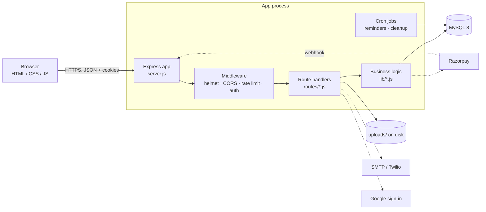
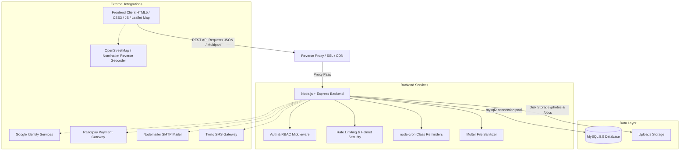

# TutorLink

> A home-tuition marketplace that matches students with admin-approved tutors by real distance.

[](https://github.com/Ayush-T-iwar-i/tutorlink-website/actions)


TutorLink is a full-stack web application with three role-based workspaces — **Student**, **Teacher** and **Admin**. Students search for tutors near them, book a demo or recurring class, chat with the tutor, pay online or in cash, and review the class. Teachers manage their profile, availability, bookings, earnings and replies. Admins approve tutors, handle reports, and see platform statistics.

It is built for the Indian market (INR payments, Indian mobile-number validation, `Asia/Kolkata` as the default timezone).

**Project status:** under active development. Version `1.0.0` (from `backend/package.json`). The core flows below are implemented and covered by automated tests. See [Current gaps](#current-gaps) for what is **not** finished — please read it before deploying to production.

> The repository is a single Node.js application: the Express backend also serves the static frontend.

---

## Table of contents

- [Links](#links)
- [Screenshots](#screenshots)
- [Features](#features)
- [Feature status](#feature-status)
- [Tech stack](#tech-stack)
- [Architecture](#architecture)
- [Project structure](#project-structure)
- [Prerequisites](#prerequisites)
- [Installation](#installation)
- [Environment variables](#environment-variables)
- [Database](#database)
- [Running the project](#running-the-project)
- [Docker](#docker)
- [API reference](#api-reference)
- [Authentication](#authentication)
- [Authorization (roles)](#authorization-roles)
- [Security](#security)
- [Error handling](#error-handling)
- [Logging and monitoring](#logging-and-monitoring)
- [Testing](#testing)
- [CI/CD](#cicd)
- [Deployment](#deployment)
- [Production checklist](#production-checklist)
- [Performance](#performance)
- [Accessibility and responsive design](#accessibility-and-responsive-design)
- [User flows](#user-flows)
- [Design decisions](#design-decisions)
- [Current gaps](#current-gaps)
- [Troubleshooting](#troubleshooting)
- [FAQ](#faq)
- [Roadmap](#roadmap)
- [Future features](#future-features)
- [Versioning and changelog](#versioning-and-changelog)
- [Contributing](#contributing)
- [Security reporting](#security-reporting)
- [Credits](#credits)
- [License](#license)

---

## Links

|                                   |                                                                                     |
| --------------------------------- | ----------------------------------------------------------------------------------- |
| Repository                        | https://github.com/Ayush-T-iwar-i/tutorlink-website                                 |
| Live demo                         | Coming soon                                                                         |
| Hosted API docs (Swagger/OpenAPI) | Not implemented — see[API reference](#api-reference)                                |
| Docker image                      | Not published (build locally, see[Docker](#docker))                                  |
| Releases / changelog              | None published yet                                                                  |
| API collection                    | `backend/tests/TutorLink.postman_collection.json` (not verified to be up to date) |

## Screenshots

Screenshots will be added soon. The repository currently contains no screenshot images.

---

## Features

### Currently implemented

**Accounts and authentication**

- Student and teacher signup (admins are created with a script, never through signup).
- Email + password login, and "Continue with Google" sign-in.
- Email verification (24-hour single-use link) with a resend cooldown.
- Forgot / reset password (1-hour single-use link) and change password.
- Short-lived access tokens with silent refresh, per-device sessions, logout, and "log out of all devices".
- Brute-force protection on login.

**Students**

- Search tutors by subject and city (`/browse`) or by distance from coordinates (`/nearby`, server-side Haversine calculation).
- View a tutor's profile, reviews and free/taken slots for a date.
- Book a **demo** (one class) or **recurring** classes (selected weekdays for 8 weeks).
- Cancel a booking; favourite tutors; per-booking chat; notifications.
- Pay online with Razorpay (if configured) — or pay the teacher in cash.
- Review a tutor after a class is marked completed; report a user.
- Profile with photo and saved location; account settings.

**Teachers**

- Profile completion: subjects, qualification, experience, fee, location, available time slots, photo, and ID/address/certificate documents.
- Accept (with a fee) or decline booking requests; mark classes completed or cancelled.
- Record cash payments; view earnings and a class schedule.
- Reply to reviews; chat with students; notifications.
- Course and module management for active tuition relationships (the LMS foundation — see [Current gaps](#current-gaps)).

**Admin**

- Approve / reject / mark under review tutor applications and view their uploaded documents.
- Platform statistics and a signups-per-day chart.
- Review and resolve user reports.
- CSV export of students and teachers.
- List all payments and issue or retry refunds for online payments.

**Platform**

- Booking engine that prevents double-booking, even under simultaneous requests (database-level guarantee).
- Payment ledger with signature-verified Razorpay webhooks, idempotent processing and automatic refunds for cancelled classes.
- Class reminders by email/SMS (cron job every 15 minutes); daily cleanup job.
- Email (SMTP) and SMS (Twilio) integrations that fall back to console logging when not configured.
- Public pages: landing page, tutor listing, terms, privacy, 404, `robots.txt`, `sitemap.xml`.

### Not implemented (see the roadmap)

Admin user suspension/deletion, admin views for bookings/reviews, account deletion and data export, real-time (WebSocket) chat, assignments API, automated end-to-end browser tests, structured logging, metrics/monitoring, automated backups.

---

## Feature status

| Feature                              | Status                | Notes                                                                                                                                                   |
| ------------------------------------ | --------------------- | ------------------------------------------------------------------------------------------------------------------------------------------------------- |
| Signup / login / logout              | ✅ Complete           | Cookie sessions, tested against real MySQL                                                                                                              |
| Email verification                   | ✅ Complete           | Required for booking, accepting a class and paying                                                                                                      |
| Password reset / change              | ✅ Complete           | Signs out other devices                                                                                                                                 |
| Google sign-in                       | ✅ Complete           | Needs`GOOGLE_CLIENT_ID`; tested with a mocked Google verifier only                                                                                    |
| Tutor search (subject/city/distance) | ✅ Complete           | Pagination on both endpoints                                                                                                                            |
| Booking (demo / recurring)           | ✅ Complete           | Transactional, conflict-checked                                                                                                                         |
| Availability endpoint                | ✅ Complete (API)     | 🟡 Not yet wired into the student dashboard UI                                                                                                          |
| Online payments (Razorpay)           | 🟡 Partial            | Backend complete and tested with a mocked gateway;**never run against the real Razorpay API**; UI does not yet handle the "payment pending" state |
| Cash payment recording               | ✅ Complete           | Teacher only; cannot alter online payments                                                                                                              |
| Refunds                              | ✅ Complete (backend) | Policy configurable via`REFUND_WINDOW_HOURS`                                                                                                          |
| Reviews + teacher replies            | ✅ Complete           | One review per completed booking                                                                                                                        |
| Reports                              | ✅ Complete           | Admin can review/resolve                                                                                                                                |
| Chat                                 | 🟡 Partial            | Per-booking, polled every 5 s (no WebSocket), 1000-character limit                                                                                      |
| Notifications                        | 🟡 Partial            | In-app list, polled; email/SMS for key events                                                                                                           |
| Admin dashboard                      | 🟡 Partial            | Tutor approval, stats, reports, exports, payments; no user management                                                                                   |
| Courses / modules (LMS)              | 🟡 Partial            | Course + module APIs exist                                                                                                                              |
| Assignments                          | ❌ Not implemented    | Tables exist (`assignments`, `assignment_submissions`); there are no routes or UI                                                                   |
| Content-Security-Policy              | ❌ Not implemented    | Explicitly disabled in`server.js`                                                                                                                     |
| Structured logging / metrics         | ❌ Not implemented    | See[Logging and monitoring](#logging-and-monitoring)                                                                                                     |
| End-to-end browser tests             | ❌ Not implemented    |                                                                                                                                                         |
| OpenAPI / Swagger docs               | ❌ Not implemented    |                                                                                                                                                         |

---

## Tech stack

**Frontend** — plain HTML, CSS and JavaScript (no framework, no build step). Libraries are loaded from CDNs: Leaflet 1.9.4 (maps, unpkg), Chart.js 4.4.0 (admin charts, jsDelivr), Razorpay Checkout, Google Identity Services, Google Fonts. Address geocoding calls OpenStreetMap Nominatim directly from the browser. API calls go through `frontend/js/api.js`.

**Backend** — Node.js (≥ 18; Docker image uses 20), Express 4, `mysql2` (promise pool), `express-validator`, `jsonwebtoken`, `bcryptjs`, `helmet`, `cors`, `express-rate-limit`, `compression`, `cookie-parser`, `morgan`, `multer` + `file-type` (uploads), `node-cron` (jobs), `nodemailer` (email), `twilio` (SMS), `razorpay`, `google-auth-library`.

**Database** — MySQL 8.0 (no ORM; parameterised SQL through `mysql2`). No cache layer.

**Storage** — local disk under `backend/uploads` (a Docker volume in `docker-compose.yml`).

**Testing** — Jest and Supertest. Unit tests mock the database; integration tests run against a real MySQL database.

**DevOps** — GitHub Actions, multi-stage Dockerfile, Docker Compose. A `backend/Procfile` also exists (`web: node server.js`).

> `cloudinary` is listed in `package.json` but is not used anywhere in the code.

---

## Architecture

TutorLink is a single deployable: one Express process serves the REST API under `/api`, the static frontend, and runs the background jobs. State lives in MySQL and on local disk.



**Request flow.** Browser → Express → global middleware (compression, helmet, CORS, body parsers, rate limiters) → route → `verifyToken` (session lookup in MySQL) → role / ownership checks → handler → SQL → JSON response. Slow side effects (emails, SMS, notifications, refunds) run **after** the response is sent (`lib/after-response.js`) so users never wait on a provider.

**Authentication flow.** See [Authentication](#authentication).

**Booking flow.** `POST /api/bookings` opens a transaction, locks the teacher's row and then the student's row (always in that order), checks every conflict, and inserts. A unique index on active bookings is a second, database-level guard.

**Payment flow.** The server creates a Razorpay order for the fee stored in the database → the browser pays in Razorpay Checkout → either the browser calls `/api/payments/verify` or Razorpay calls `/api/payments/webhook`. Both paths run the same idempotent function, so whichever arrives first settles the payment and the other is a no-op.

**Background jobs** (started in `server.js` unless `NODE_ENV=test`): class reminders every 15 minutes; cleanup daily at 03:15 server time. Jobs run inside the app process — if you run several instances, each runs its own job (see [Current gaps](#current-gaps)).

**Time handling.** Dates are `YYYY-MM-DD` strings and times are labels such as `5:00 PM`. "Today" and "in the past" are always evaluated in `APP_TIMEZONE` (default `Asia/Kolkata`), never in the server's timezone.

---

## Project structure

```text
tutorlink-website/
├── backend/
│   ├── server.js                 # app wiring: middleware, routes, health, error handler, jobs
│   ├── config/                   # db pool, email, SMS, Razorpay client, email templates
│   ├── routes/                   # one file per API area (auth, bookings, payments, ...)
│   ├── middleware/               # auth (sessions, roles), file upload validation
│   ├── lib/                      # business rules and shared logic (see below)
│   ├── jobs/                     # reminders.js, cleanup.js
│   ├── database/                 # schema.sql, migration_N_*.sql, migrate.js
│   ├── tests/                    # unit tests; tests/integration/ runs on real MySQL
│   ├── create-admin.js           # creates an administrator (no secrets in the file)
│   ├── Procfile
│   ├── .env.example
│   └── package.json
├── frontend/                     # static site served by Express
│   ├── *.html                    # pages (login, dashboards, tutor listing, legal, 404, ...)
│   ├── css/style.css
│   └── js/                       # api.js (API + refresh helper), ui.js, google-auth.js
├── Dockerfile                    # multi-stage production image
├── docker-compose.yml            # app + MySQL
├── .env.example                  # variables for docker compose
└── .github/workflows/ci.yml
```

| `backend/lib/` file                  | Responsibility                                                                              |
| -------------------------------------- | ------------------------------------------------------------------------------------------- |
| `booking-rules.js`                   | Pure booking rules: validation, timezone-safe dates, conflict detection, status transitions |
| `payments.js`                        | Signatures, paise conversion, "payment captured" logic, refunds                             |
| `payment-jobs.js`                    | Post-commit refund execution and notifications                                              |
| `sessions.js`, `session-tokens.js` | Session table access, access/refresh tokens, cookies                                        |
| `login-throttle.js`                  | Failed-login counters and lockouts                                                          |
| `passwords.js`                       | Password policy and bcrypt hashing                                                          |
| `tx.js`                              | Transaction helper with deadlock retry                                                      |
| `after-response.js`                  | Run work after the HTTP response; drained on shutdown                                       |

---

## Prerequisites

| Requirement             | Version                      | Source                                                                                                                               |
| ----------------------- | ---------------------------- | ------------------------------------------------------------------------------------------------------------------------------------ |
| Node.js                 | 18 or newer (20 recommended) | `engines` in `package.json`; CI tests 18 and 20; Dockerfile uses 20                                                              |
| MySQL                   | 8.0                          | CI service and`docker-compose.yml`. The booking constraints use MySQL 8 features (`CHECK`, generated columns, `FOR UPDATE OF`) |
| npm                     | bundled with Node            | `package-lock.json` is committed; use `npm ci`                                                                                   |
| Docker + Docker Compose | optional                     | only for the container setup                                                                                                         |
| Git                     | any recent version           |                                                                                                                                      |

---

## Installation

```bash
git clone https://github.com/Ayush-T-iwar-i/tutorlink-website.git
cd tutorlink-website/backend
npm ci
cp .env.example .env      # Windows PowerShell: Copy-Item .env.example .env
```

Edit `backend/.env`: set at least `DB_USER`, `DB_PASSWORD`, `DB_NAME` and `JWT_SECRET` (see [Environment variables](#environment-variables)). Then create the database and tables:

```bash
npm run db:migrate
```

Create your first administrator:

```bash
npm run admin:create
```

Start the app:

```bash
npm run dev          # nodemon, restarts on change
# or
npm start
```

Open http://localhost:5000. There is no separate frontend server: Express serves `frontend/`.

> Optional: if you open the HTML files from a different dev server (for example Live Server on port 5500), `frontend/js/api.js` automatically points API calls at `http://localhost:5000`; set `ALLOWED_ORIGIN` accordingly.

---

## Environment variables

Defined in `backend/.env.example`. Never commit `.env` (it is in `.gitignore`).

| Variable                                                                                     | Required                         | Purpose                                                                                                                                     | Example / default                                                                     |
| -------------------------------------------------------------------------------------------- | -------------------------------- | ------------------------------------------------------------------------------------------------------------------------------------------- | ------------------------------------------------------------------------------------- |
| `NODE_ENV`                                                                                 | No                               | `production` enables secure cookies, requires `ALLOWED_ORIGIN`, requires a 32+ character `JWT_SECRET`                                 | `development`                                                                       |
| `PORT`                                                                                     | No                               | HTTP port                                                                                                                                   | `5000`                                                                              |
| `DB_HOST`                                                                                  | Yes                              | MySQL host                                                                                                                                  | `localhost`                                                                         |
| `DB_PORT`                                                                                  | No                               | MySQL port                                                                                                                                  | `3306`                                                                              |
| `DB_USER`                                                                                  | Yes                              | MySQL user                                                                                                                                  | `root`                                                                              |
| `DB_PASSWORD`                                                                              | Yes                              | MySQL password                                                                                                                              | *(your password)*                                                                   |
| `DB_NAME`                                                                                  | Yes                              | Database name (created by`db:migrate` if missing)                                                                                         | `tutorlink`                                                                         |
| `DB_POOL_SIZE`                                                                             | No                               | Max pooled connections                                                                                                                      | `10`                                                                                |
| `JWT_SECRET`                                                                               | **Yes**                    | Signs access tokens. The server refuses to start without it, and in production without 32+ characters                                       | output of`node -e "console.log(require('crypto').randomBytes(48).toString('hex'))"` |
| `ACCESS_TOKEN_TTL_MIN`                                                                     | No                               | Access-token lifetime (minutes)                                                                                                             | `15`                                                                                |
| `REFRESH_TOKEN_TTL_DAYS`                                                                   | No                               | Refresh-token idle lifetime (days; hard cap 90 per login)                                                                                   | `14`                                                                                |
| `BCRYPT_ROUNDS`                                                                            | No                               | bcrypt cost, 4–15                                                                                                                          | `12`                                                                                |
| `ALLOWED_ORIGIN`                                                                           | Production: yes                  | CORS origin.`*` or empty is refused in production                                                                                         | `https://your-domain.com`                                                           |
| `FRONTEND_URL`                                                                             | Recommended                      | Base URL used in emailed links (verify / reset). Falls back to the request host                                                             | `https://your-domain.com`                                                           |
| `APP_TIMEZONE`                                                                             | No                               | IANA timezone for "today", reminders and booking checks                                                                                     | `Asia/Kolkata`                                                                      |
| `DEFAULT_RADIUS_KM`                                                                        | No                               | Default search radius                                                                                                                       | `5`                                                                                 |
| `GOOGLE_CLIENT_ID`                                                                         | No                               | Enables Google sign-in                                                                                                                      | from Google Cloud Console                                                             |
| `SMTP_HOST`, `SMTP_PORT`, `SMTP_USER`, `SMTP_PASS`, `SMTP_FROM`                    | No                               | Email. If unset, emails are logged to the console instead of sent                                                                           | e.g.`smtp.gmail.com`, `587`                                                       |
| `TWILIO_ACCOUNT_SID`, `TWILIO_AUTH_TOKEN`, `TWILIO_PHONE_NUMBER`                       | No                               | SMS. If unset, SMS is logged to the console                                                                                                 | from the Twilio console                                                               |
| `RAZORPAY_KEY_ID`, `RAZORPAY_KEY_SECRET`                                                 | No                               | Online payments. If unset, only cash payment works                                                                                          | `rzp_test_...` while testing                                                        |
| `RAZORPAY_WEBHOOK_SECRET`                                                                  | Required with Razorpay           | Verifies webhook signatures. Different from the key secret                                                                                  | secret you set in the Razorpay dashboard                                              |
| `REFUND_WINDOW_HOURS`                                                                      | No                               | A*student* cancellation earlier than this before class is refunded automatically (teacher cancellations always are)                       | `24`                                                                                |
| `ADMIN_NAME`, `ADMIN_EMAIL`, `ADMIN_PHONE`, `ADMIN_PASSWORD`                         | Only for`npm run admin:create` | Non-interactive input for the admin script. If unset the script asks interactively (password hidden). Never store these in a committed file | —                                                                                    |
| `TEST_DB_HOST`, `TEST_DB_PORT`, `TEST_DB_USER`, `TEST_DB_PASSWORD`, `TEST_DB_NAME` | Integration tests only           | Throw-away database that is**dropped and recreated** on each run; the name must end in `_test`                                      | `tutorlink_test`                                                                    |

Docker Compose reads a **separate** `.env` at the repository root — see [Docker](#docker) and the root `.env.example`.

---

## Database

- **Engine:** MySQL 8.0, `utf8mb4`.
- **Tables:** `users`, `students`, `teachers`, `bookings`, `class_sessions`, `reviews`, `reports`, `favorites`, `messages`, `notifications`, `enrollments`, `courses`, `course_modules`, `assignments`, `assignment_submissions`, `payments`, `payment_events`, `sessions`, `login_failures`, and `schema_migrations` (migration bookkeeping).
- **Schema and migrations:** `backend/database/schema.sql` is the baseline; `migration_2_*.sql` … `migration_19_*.sql` are applied in numeric order.

```bash
cd backend
npm run db:migrate      # create DB if needed, apply anything not yet applied
```

The runner (`database/migrate.js`) records each applied file in `schema_migrations`, runs statement by statement, tolerates "already exists" errors (so databases created by older versions upgrade cleanly), and takes a MySQL advisory lock so two containers starting together cannot migrate at once. `npm run db:init` still works and calls the same runner. The Docker image runs migrations on every start.

Important integrity rules enforced **in the database**:

| Rule                                                    | Mechanism                                                  |
| ------------------------------------------------------- | ---------------------------------------------------------- |
| One active booking per teacher + date + time            | Unique index on a generated column (`bookings.slot_key`) |
| A fee can never be negative                             | `CHECK (fee >= 0)`                                       |
| One*active* payment per booking                       | Unique index on`payments.active_booking_key`             |
| A Razorpay order / payment / refund id is recorded once | Unique indexes                                             |
| A webhook event is processed once                       | `payment_events.event_id` primary key                    |
| Class sessions are not duplicated                       | Unique`(booking_id, session_date, session_time)`         |

There is no seed-data script. Create an admin with `npm run admin:create`.

---

## Running the project

```bash
cd backend
npm run dev        # development (nodemon)
npm start          # production-style start
npm run db:migrate # apply migrations (also run automatically in Docker)
```

There is no frontend build step.

---

## Docker

```bash
cp .env.example .env     # in the repository ROOT (not backend/)
# edit .env: set DB_PASSWORD, MYSQL_ROOT_PASSWORD and JWT_SECRET (required)
docker compose up --build
```

`docker compose` **stops with an error** until `DB_PASSWORD`, `MYSQL_ROOT_PASSWORD` and `JWT_SECRET` are set — there are deliberately no default secrets.

| Service | Details                                                                                                                                                                                                     |
| ------- | ----------------------------------------------------------------------------------------------------------------------------------------------------------------------------------------------------------- |
| `app` | Built from`Dockerfile` (multi-stage, `node:20-alpine`, runs as a non-root user). Port `5000`. On start it runs `node database/migrate.js`, then `node server.js`. Health check calls `/health`. |
| `db`  | `mysql:8.0`, data in the `mysql_data` volume. Published on `127.0.0.1:3306` only — remove the `ports:` entry in production.                                                                        |
| Volumes | `mysql_data` (database), `tutorlink_uploads` (uploaded photos and documents)                                                                                                                            |

Create the first admin inside the running container:

```bash
docker compose exec \
  -e ADMIN_NAME="Your Name" -e ADMIN_EMAIL="you@example.com" \
  -e ADMIN_PHONE="9XXXXXXXXX" -e ADMIN_PASSWORD="a-strong-password" \
  app node create-admin.js
```

The container serves plain HTTP. For HTTPS put a reverse proxy in front (none is included).

---

## API reference

All routes are under `/api`. JSON in, JSON out. Authentication is a cookie (set by login/signup); `Authorization: Bearer <access token>` is also accepted for non-browser clients. "Verified" means the account's email must be verified. There is no Swagger/OpenAPI document; a Postman collection exists in `backend/tests/`.

### Auth — `/api/auth`

| Method | Path                     | Auth           | Description                                                        |
| ------ | ------------------------ | -------------- | ------------------------------------------------------------------ |
| POST   | `/signup`              | —             | Create a student or teacher account                                |
| POST   | `/login`               | —             | Log in; sets the`token` and `refresh_token` cookies            |
| POST   | `/refresh`             | refresh cookie | Rotate the refresh token, issue a new access token                 |
| POST   | `/google`              | —             | Sign in / sign up with a Google ID token                           |
| POST   | `/forgot-password`     | —             | Email a reset link (same answer whether or not the account exists) |
| POST   | `/reset-password`      | —             | Set a new password with a reset token                              |
| PUT    | `/change-password`     | Yes            | Change password; other devices are signed out                      |
| GET    | `/me`                  | Yes            | Current user                                                       |
| GET    | `/verify-email?token=` | —             | Verify email with the emailed token                                |
| POST   | `/resend-verification` | Yes            | New verification email (60 s cooldown)                             |
| POST   | `/logout`              | —             | End the current session and clear cookies                          |
| POST   | `/logout-all`          | Yes            | End all sessions                                                   |

### Teachers — `/api/teachers`

| Method | Path                                          | Auth            | Description                                            |
| ------ | --------------------------------------------- | --------------- | ------------------------------------------------------ |
| GET    | `/browse?subject&city&sort&page&limit`      | —              | Search approved tutors (limit ≤ 50)                   |
| GET    | `/nearby?lat&lng&radius&subject&page&limit` | —              | Search by distance                                     |
| GET    | `/:id`                                      | —              | Public tutor profile                                   |
| GET    | `/by-user/:userId`                          | Owner           | Own teacher record                                     |
| PUT    | `/:userId/profile`                          | Teacher (owner) | Update profile                                         |
| PUT    | `/:userId/location`                         | Teacher (owner) | Update location                                        |
| POST   | `/:userId/photo`                            | Owner           | Upload profile photo                                   |
| POST   | `/:userId/documents`                        | Teacher (owner) | Upload`id_proof`, `address_proof`, `certificate` |
| GET    | `/:userId/documents/:type`                  | Owner or admin  | Download a document                                    |

### Students — `/api/students`

| Method | Path                     | Auth            | Description          |
| ------ | ------------------------ | --------------- | -------------------- |
| GET    | `/by-user/:userId`     | Owner           | Own student record   |
| PUT    | `/:userId/location`    | Student (owner) | Update location      |
| PUT    | `/:userId/preferences` | Student (owner) | Update preferences   |
| POST   | `/:userId/photo`       | Owner           | Upload profile photo |

### Bookings — `/api/bookings`

| Method | Path                                         | Auth              | Description                                                                        |
| ------ | -------------------------------------------- | ----------------- | ---------------------------------------------------------------------------------- |
| POST   | `/`                                        | Student, verified | Create a booking request                                                           |
| GET    | `/availability/:teacherId?date=YYYY-MM-DD` | Yes               | Which slots are free that day                                                      |
| PUT    | `/:id/cancel`                              | Student (owner)   | Cancel                                                                             |
| PUT    | `/:id/status`                              | Teacher (owner)   | `accepted` (needs `fee`; verified), `declined`, `completed`, `cancelled` |
| PUT    | `/:id/payment`                             | Teacher (owner)   | Record/undo/refund a**cash** payment only                                    |
| GET    | `/student/me`, `/teacher/me`             | Student / Teacher | Own bookings                                                                       |
| GET    | `/teacher/earnings`, `/teacher/schedule` | Teacher           | Earnings and schedule                                                              |
| GET    | `/:id/sessions`                            | Participant       | Class sessions of a booking                                                        |

`POST /api/bookings` body: `{ teacher_id, type: "demo"|"recurring", subject?, booking_date: "YYYY-MM-DD", booking_time: "5:00 PM", days_per_week?: "Mon,Wed" }`. A `fee` sent by the client is ignored. Typical errors: `400` validation, `404` teacher not found, `409` with `code` `DUPLICATE_BOOKING`, `SLOT_TAKEN` or `STUDENT_BUSY`.

Status transitions: `requested → accepted | declined`, `accepted → completed | cancelled`; a student can cancel `requested` or `accepted`. Everything else returns `409`.

### Payments — `/api/payments`

| Method | Path              | Auth                              | Description                                                                                    |
| ------ | ----------------- | --------------------------------- | ---------------------------------------------------------------------------------------------- |
| POST   | `/create-order` | Student, verified                 | Create (or reuse) a Razorpay order; amount comes from the database                             |
| POST   | `/verify`       | Student                           | Confirm a payment after Checkout (signature + server-side check with Razorpay)                 |
| POST   | `/webhook`      | Razorpay signature                | Razorpay events:`payment.captured`, `order.paid`, `payment.failed`, `refund.processed` |
| GET    | `/booking/:id`  | Student or teacher of the booking | Payment status (for polling after a`202`)                                                    |

`/verify` returns `200` when paid, `202` when Razorpay has not captured yet (the webhook finishes the job), `409` on an amount mismatch.

### Other areas

| Area                                | Endpoints                                                                                                                                        | Auth        |
| ----------------------------------- | ------------------------------------------------------------------------------------------------------------------------------------------------ | ----------- |
| Reviews`/api/reviews`             | `POST /`, `PUT /:id`, `DELETE /:id` (student); `PUT /:id/reply` (teacher); `GET /teacher/:teacherId` (public)                          | see left    |
| Favorites`/api/favorites`         | `GET /me`, `POST /`, `DELETE /:teacherId`                                                                                                  | Student     |
| Messages`/api/messages`           | `GET /:bookingId`, `POST /:bookingId` (max 1000 chars; only the two participants; sending is blocked while a booking is still `requested`) | Participant |
| Notifications`/api/notifications` | `GET /me`, `PUT /:id/read`, `PUT /read-all`                                                                                                | Yes         |
| Reports`/api/reports`             | `POST /` (reasons: `no_show`, `inappropriate_behaviour`, `payment_issue`, `fake_profile`, `other`), `GET /mine`                    | Yes         |
| Enrollments`/api/enrollments`     | `GET /`, `GET /:id`, `PUT /:id/status` (teacher)                                                                                           | Yes         |
| Courses`/api/courses`             | list/detail; teacher: create, update, manage`modules`                                                                                          | Yes         |
| Config`/api/config`               | `GET /` — public Google client id and default radius                                                                                          | —          |

### Admin — `/api/admin` (admin role only)

| Method | Path                                       | Description                                      |
| ------ | ------------------------------------------ | ------------------------------------------------ |
| GET    | `/teachers/pending`                      | Tutors awaiting approval                         |
| PUT    | `/teachers/:id/verification`             | `approved`, `rejected` or `under_review`   |
| GET    | `/stats`, `/stats/signups-by-day`      | Platform statistics                              |
| GET    | `/reports`; PUT `/reports/:id`         | Review / resolve reports                         |
| GET    | `/export/students`, `/export/teachers` | CSV exports                                      |
| GET    | `/payments?status=&page=`                | Payments ledger                                  |
| POST   | `/payments/:id/refund`                   | Refund or retry a stuck refund (online payments) |

### Utility

| Method | Path        | Description                                                                                                                        |
| ------ | ----------- | ---------------------------------------------------------------------------------------------------------------------------------- |
| GET    | `/health` | `200 {status:"ok", database:"connected", uptime_seconds, timestamp}`; `503` with `status:"degraded"` if MySQL is unreachable |

---

## Authentication

1. **Signup / login** create a row in the `sessions` table and set two **httpOnly**, `SameSite=Lax` cookies (`Secure` in production):
   - `token` — a JWT access token valid for **15 minutes**, containing the user id, role and session id.
   - `refresh_token` — an opaque random value, valid for **14 days of inactivity** (never more than 90 days per login), sent only to `/api/auth/*`. Only its SHA-256 hash is stored.
2. **Every protected request** verifies the JWT signature (HS256 only) **and** checks that the session row is still alive and the user still exists. The user's role is read from the database, never trusted from the token.
3. **Silent refresh.** When a call returns `401`, `frontend/js/api.js` calls `POST /api/auth/refresh` once (shared between simultaneous calls) and repeats the request.
4. **Rotation and theft detection.** Each refresh rotates the refresh token. Presenting an already-replaced token more than 10 seconds later revokes the whole session. Within 10 seconds (a second browser tab) it is tolerated.
5. **Revocation.** Logout, password change/reset, "log out of all devices", and user deletion take effect immediately.
6. **One-time tokens** (password reset, email verification) are 256-bit random values, stored only as SHA-256 hashes, single-use, and expire after 1 hour / 24 hours.
7. **Passwords:** 8–72 bytes, at least one upper-case letter, one lower-case letter and one digit, not on a short list of very common passwords; hashed with bcrypt (cost 12 by default).
8. **Login throttling:** 5 failures lock an (email, IP) pair for 15 minutes; 25 failures across all IPs throttle the account. Unknown emails are tracked identically, so lockouts and error messages never reveal whether an account exists.
9. **Google sign-in** is accepted only when Google reports the email as verified, and never links two different Google identities to one account.

---

## Authorization (roles)

| Role        | How it is created                                                                  | Can do                                                                                                                 |
| ----------- | ---------------------------------------------------------------------------------- | ---------------------------------------------------------------------------------------------------------------------- |
| `student` | Signup                                                                             | Search, book, cancel, pay, chat, review, report, favourite                                                             |
| `teacher` | Signup (must be approved by an admin before appearing in search or being bookable) | Manage profile and documents, accept/decline/complete bookings, record cash payments, reply to reviews, manage courses |
| `admin`   | `npm run admin:create` only                                                      | Everything under`/api/admin`                                                                                         |

Enforcement is server-side: `requireRole(...)` for role checks, `requireOwnUser` for `/:userId/...` routes, and ownership joins in SQL (for example, a booking can only be changed by the teacher or student on it). Frontend role checks are convenience only.

---

## Security

### Implemented

- Passwords hashed with bcrypt; password hashes never returned by the API.
- Parameterised SQL everywhere (`mysql2` placeholders).
- httpOnly cookies; access tokens expire in 15 minutes; server-side session revocation; refresh-token rotation with reuse detection.
- Login brute-force protection and no account enumeration on login or password-reset requests.
- Role- and ownership-based authorisation on the server, covered by IDOR tests.
- `helmet` default security headers (CSP disabled — see gaps), `compression`, JSON body limit of 2 MB.
- CORS restricted to `ALLOWED_ORIGIN`; the server refuses to start in production if it is `*` or missing.
- Rate limiting: `/api/auth` 30 requests / 15 min / IP; `/api` 500 requests / 15 min / IP.
- File uploads: 5 MB limit, MIME-type allow-list (JPG, PNG, WEBP, PDF), real content type checked with `file-type`, server-generated file names. Identity documents are **not** served statically; only the owner or an admin can fetch them through an authenticated route.
- Payments: amounts always come from the database; payments are marked paid only after signature verification **and** a server-side check with Razorpay, or a signature-verified webhook; duplicate webhooks and double payments are handled; the cash-payment endpoint cannot modify online payments.
- Database constraints that prevent double booking and double payment even if application code is bypassed.
- Docker image runs as a non-root user; compose has no default secrets.
- `JWT_SECRET` is required; production requires 32+ characters.

### Not yet implemented (recommended)

- Content-Security-Policy (currently disabled) and a review of other headers (HSTS is expected to be set by the reverse proxy).
- CSRF tokens (today protection relies on `SameSite=Lax` cookies plus JSON-only endpoints).
- Multi-factor authentication; per-device session list in the UI.
- Output encoding review of all frontend `innerHTML` usage and of user-supplied text in email templates.
- Antivirus scanning of uploads; encryption of stored documents.
- Dependency vulnerability gating in CI (see gaps).

---

## Error handling

Most API errors look like:

```json
{ "error": "Human readable message", "code": "MACHINE_READABLE_CODE" }
```

`code` is present on the booking, payment and session endpoints (for example `SLOT_TAKEN`, `EMAIL_NOT_VERIFIED`, `TOKEN_EXPIRED`); older endpoints return only `error`. Validation failures from `express-validator` return `422` with the first message. Status codes in use: `400` bad input, `401` not logged in / session ended, `403` forbidden, `404` not found, `409` conflict, `422` validation, `423` login locked, `429` rate-limited or resend cooldown, `500` server error, `502` payment provider error, `503` service not configured.

A global handler catches uncaught errors and returns a generic message outside `NODE_ENV=development` (no stack traces). Unknown `/api/*` routes return a JSON `404`; other unknown URLs return the HTML 404 page. The response shape is **not yet uniform** across every route (see gaps).

---

## Logging and monitoring

- **Request logs:** `morgan('dev')` (disabled under `NODE_ENV=test`).
- **Errors:** written with `console.error`. Operational problems that need a human (failed refunds, payment mismatches) are logged with the prefix `ACTION REQUIRED:`.
- **Request id:** an `X-Request-Id` header is set, but it is random and not written to the logs, so it cannot yet be used for correlation.
- **Health check:** `GET /health` (also used by the Docker health checks).
- **Not implemented:** structured (JSON) logs, log shipping, metrics, alerting, error tracking.

---

## Testing

```bash
cd backend
npm test                   # unit tests — no database needed
npm run test:integration   # real MySQL; see below
npm run test:all           # both
npm run test:coverage      # coverage for unit tests
```

Integration tests need a MySQL server and credentials that may **create and drop** a database named `tutorlink_test` (the runner refuses any database name that does not end in `_test`):

```bash
# Linux / macOS
TEST_DB_USER=root TEST_DB_PASSWORD=your_password npm run test:integration
# Windows PowerShell
$env:TEST_DB_USER="root"; $env:TEST_DB_PASSWORD="your_password"; npm run test:integration
```

At the time of writing there are **299 tests** (140 unit, 159 integration). No coverage percentage is published because coverage is not measured in CI.

| Area                       | Where                                                                             | What is covered                                                                                                                            |
| -------------------------- | --------------------------------------------------------------------------------- | ------------------------------------------------------------------------------------------------------------------------------------------ |
| Booking rules              | `tests/booking-rules.test.js`                                                   | Time slots, timezone handling, recurring dates, conflicts, status transitions                                                              |
| Booking API                | `tests/integration/booking.integration.test.js`                                 | Validation, conflicts, 8 simultaneous requests for one slot, transitions, atomic accept, IDOR                                              |
| Payments                   | `tests/payments-lib.test.js`, `tests/integration/payment.integration.test.js` | Signatures, idempotency, webhooks, duplicates, refunds, cash-payment lock, admin refunds (Razorpay API is mocked)                          |
| Authentication             | `tests/auth*.test.js`, `tests/integration/auth.integration.test.js`           | Signup/login, enumeration parity, lockouts, refresh rotation and reuse, logout, reset/change password, email verification, Google (mocked) |
| Authorization / security   | `tests/security.test.js` and the integration suites                             | IDOR checks, SQL-injection payloads, role enforcement                                                                                      |
| Reviews, reports, teachers | `tests/review.test.js`, `report.test.js`, `teacher.test.js`                 | Mock-database unit tests                                                                                                                   |

**Safety:** the integration suite blanks all SMTP/Twilio/Razorpay/Google variables, so a test run never contacts a real provider even if your `.env` contains real credentials.

Not covered: end-to-end browser tests, frontend unit tests, load tests, and anything that needs real Razorpay, Google, SMTP or Twilio. `backend/tests/testing-checklist.md` is an older manual checklist and is partly out of date.

---

## CI/CD

`.github/workflows/ci.yml` runs on pushes and pull requests to `main` and `develop`:

```text
push / PR
   ↓
test job (Node 18 and 20, with a MySQL 8 service)
   ├─ npm ci
   ├─ unit tests
   └─ integration tests on real MySQL
   ↓
docker-build job: builds the image (does not push it)
```

There is **no** lint step, dependency-audit step, coverage upload, image publishing or automatic deployment.

---

## Deployment

What exists in the repository: a production `Dockerfile`, `docker-compose.yml`, a `backend/Procfile` (`web: node server.js`), and a `/health` endpoint. No platform-specific configuration (Render, Railway, AWS, Vercel, …) is included, and deployment to any specific platform has **not** been verified.

Generic steps for any host that can run Node 18+ or Docker:

1. **Database:** provision MySQL 8. Create a dedicated user with privileges on the application database only.
2. **Environment:** set the variables above. In production `NODE_ENV=production`, `JWT_SECRET` (32+ chars) and `ALLOWED_ORIGIN` (your real origin) are mandatory; set `FRONTEND_URL` too.
3. **Migrations:** the Docker image runs them on start. Elsewhere run `npm run db:migrate` before starting (the `Procfile` does **not** do this).
4. **Start:** `npm start` in `backend/` (or the Docker image).
5. **HTTPS:** terminate TLS at a reverse proxy / load balancer. The app sets `trust proxy` to `1` (one proxy hop) — adjust if your setup has more or fewer hops, otherwise client IPs (used by rate limiting and login lockouts) will be wrong.
6. **Uploads:** mount persistent storage at `backend/uploads` (it is on local disk).
7. **Razorpay (optional):** use live keys; in the Razorpay dashboard add a webhook to `https://YOUR-DOMAIN/api/payments/webhook` with the events `payment.captured`, `order.paid`, `payment.failed`, `refund.processed`, put its secret in `RAZORPAY_WEBHOOK_SECRET`, and enable payment auto-capture.
8. **Email/SMS:** configure SMTP and Twilio, otherwise messages only appear in the server log.
9. **Verify:** `GET /health` returns `{"status":"ok","database":"connected"}`; sign up, verify the email, log in, create the first admin with `create-admin.js`.
10. **SEO files:** `frontend/sitemap.xml` and `frontend/robots.txt` contain the placeholder domain `https://tutorlink.example.com` — replace it with your own.

Single instance only for now: jobs run inside the app process and uploads sit on local disk.

---

## Production checklist

```text
[x] Environment variables documented
[x] Secrets not committed (.env ignored; compose has no default secrets)
[x] JWT secret required and length-checked in production
[x] CORS restricted in production
[x] Authentication and authorization covered by automated tests
[x] Rate limiting enabled (coarse, per IP)
[x] Health check endpoint, Docker health checks
[x] Database migrations tracked and repeatable
[x] CI runs unit + integration tests
[x] Docker image builds in CI
[ ] HTTPS (must be provided by your proxy/host)
[ ] Content-Security-Policy
[ ] Structured logging, metrics, alerting
[ ] Database backups configured (you must set this up)
[ ] Razorpay verified against the real API and webhook
[ ] Dependency vulnerabilities resolved / audited in CI
[ ] Lint step in CI
[ ] End-to-end tests
[ ] sitemap.xml / robots.txt domain replaced
[ ] Docker image tested by you in your environment
```

**Backups and recovery.** The repository provides no backup automation. At minimum schedule `mysqldump` (or your provider's snapshots) for the database, and back up the `uploads` volume. To restore: recreate the database, load the dump, restore `uploads`, then start the app (it applies any missing migrations). Rotate `JWT_SECRET` to sign everyone out; rotating `DB_PASSWORD` or provider keys requires updating the environment and restarting.

---

## Performance

**Implemented:** MySQL connection pooling (`DB_POOL_SIZE`); indexes on the main lookup columns (including booking, session and payment lookups); pagination on tutor search (limit ≤ 50); gzip compression; static-file cache headers (HTML revalidated, assets cached); distance filtering in SQL; slow work (email, SMS, refunds) done after the response.

**Recommended:** CDN for static files; image resizing for profile photos; a shared cache or queue if the app is ever run on several instances; self-hosting the CDN libraries; load testing (none has been done).

---

## Accessibility and responsive design

- Pages are static HTML with a viewport meta tag, and `frontend/css/style.css` contains 14 `@media` rules. Layouts have **not** been systematically tested across device sizes.
- ARIA attributes are present mostly on the landing page and a few forms; the dashboards and admin page have very few. Keyboard navigation, focus management in dialogs, colour-contrast review and screen-reader testing have **not** been done. Treat accessibility as incomplete.

---

## User flows

**Student**

```text
Sign up → verify email → log in → complete profile (location)
   → search tutors → open profile → pick date and free slot
   → request booking → teacher accepts and sets a fee
   → pay online (Razorpay) or in cash → attend class
   → teacher marks it completed → leave a review
```

**Teacher**

```text
Sign up → verify email → complete profile and upload documents
   → admin approves → appears in search
   → receive booking request → accept (set fee) or decline
   → chat · record cash payment · mark completed
```

**Admin**

```text
Log in → review pending tutors and their documents → approve / reject
   → review reports → check payments and refunds → export CSV
```

**Data flow:** Browser → `api.js` → Express route → validation → `verifyToken` + role check → SQL (inside a transaction for bookings and payments) → JSON → UI.

---

## Design decisions

Stated where they can be seen in the code; otherwise marked *(inferred)*.

- **One Node process serving API and static files** keeps deployment simple (one image, no separate frontend host or build).
- **Plain HTML/JS frontend, no framework** — no build tooling to maintain *(inferred)*.
- **MySQL with hand-written SQL** — the booking and payment guarantees rely on row locks, unique indexes and generated columns, which are clearer without an ORM *(inferred)*.
- **Server-side sessions behind short-lived JWTs** so that logout and password changes take effect immediately, which a pure JWT cannot do.
- **Cookies instead of `localStorage`** for tokens so page scripts cannot read them.
- **A pending booking holds the slot** until the teacher responds, so two students cannot both be promised the same time.
- **Class duration is not modelled:** two bookings conflict only when they have the same slot label on the same date.
- **Refund policy:** teacher cancellations are always refunded; student cancellations are refunded when made at least `REFUND_WINDOW_HOURS` (default 24) before the class. Cash payments are never refunded by the system.

---

## Current gaps

Honest list of what is missing or weak today:

**Security and operations**

- Content-Security-Policy is disabled.
- `frontend` uses `innerHTML` in many places; a systematic XSS review has not been done. Email templates insert user-supplied names without HTML-escaping.
- Error responses are not uniform (`{error}` vs `{error, code}`); logging is unstructured and the request id is not logged.
- `trust proxy` is hard-coded to `1`.
- The `/api/auth` rate limit (30 / 15 min / IP) also counts `/me`, which pages call on load, so ordinary users behind one shared IP may be throttled.
- No dependency scanning in CI. `npm audit --omit=dev` currently reports 5 vulnerabilities (1 high, 4 moderate; in `nodemailer` and `uuid`) — not yet reviewed or upgraded.
- No monitoring, alerting or automated backups.
- Reminder and cleanup jobs run inside every app instance (no distributed lock), and a reminder is marked sent only after it is sent (a crash in between can cause a repeat). Run a single instance.
- Uploads are on local disk (single instance; no object storage). The unused `cloudinary` dependency is leftover.
- `backend/Procfile` starts the server without running migrations.
- Docker Compose has not been run end-to-end in the CI pipeline (only the image build is verified).

**Product**

- No admin user suspension/deletion, no admin views for bookings or reviews, no account deletion or data export for users.
- Chat and notifications are polled, not pushed.
- Assignments tables exist without an API or UI.
- The student dashboard shows a fixed list of time slots and does not yet use the availability endpoint; the payment UI does not handle the "payment pending" (`202`) or "refund started" responses.
- Teacher profile pages are not excluded in `robots.txt`; only the landing page has full Open Graph tags; `sitemap.xml` and `robots.txt` use a placeholder domain.
- The Privacy Policy, Terms of Service and landing-page copy have **not** been audited against the actual behaviour of the platform (for example refund wording).

**Process**

- No linter, no end-to-end tests, no published coverage, no OpenAPI spec, no release process or changelog.
- Razorpay, Google sign-in, SMTP and Twilio have only been tested with mocks.

---

## Troubleshooting

| Problem                                                                    | Cause                                                                                                  | Solution                                                                                       |
| -------------------------------------------------------------------------- | ------------------------------------------------------------------------------------------------------ | ---------------------------------------------------------------------------------------------- |
| `JWT_SECRET is not set ... Refusing to start`                            | Missing environment variable                                                                           | Set`JWT_SECRET` in `backend/.env` (or the root `.env` for Docker)                        |
| `ALLOWED_ORIGIN must be set ... in production`                           | `NODE_ENV=production` without a real origin                                                          | Set`ALLOWED_ORIGIN=https://your-domain`                                                      |
| `Database connection failed` / `ECONNREFUSED`                          | MySQL not running or wrong`DB_*` values                                                              | Start MySQL; check`DB_HOST`, `DB_PORT`, `DB_USER`, `DB_PASSWORD`                       |
| `Access denied for user`                                                 | Wrong DB credentials                                                                                   | Fix`DB_USER` / `DB_PASSWORD` (or `TEST_DB_*` for tests)                                  |
| Migration fails with a duplicate-key error on`uniq_bookings_active_slot` | An existing database already has two active bookings for the same teacher/date/time                    | Decline or cancel one of the duplicates, then rerun`npm run db:migrate`                      |
| `docker compose up` stops with "Set JWT_SECRET…"                        | Required secrets missing                                                                               | Copy the root`.env.example` to `.env` and fill in the three required values                |
| Everyone was logged out after an upgrade                                   | Old 7-day tokens are no longer accepted                                                                | Expected once; users log in again                                                              |
| Verification / reset link says "invalid or expired"                        | Links are single-use, expire (24 h / 1 h), and links issued before the sessions migration were cleared | Request a new link                                                                             |
| No emails arrive                                                           | SMTP not configured → emails are only printed to the server log                                       | Set`SMTP_*`; Gmail needs an app password                                                     |
| `423` on login                                                           | Too many failed attempts from that IP for that email                                                   | Wait 15 minutes or reset the password                                                          |
| Online payment button says payments are not set up                         | Razorpay keys missing (`503 PAYMENTS_DISABLED`)                                                      | Set`RAZORPAY_KEY_ID` / `RAZORPAY_KEY_SECRET`, or use cash payment                          |
| Payment succeeded but booking still unpaid                                 | Webhook not configured or not reachable                                                                | Configure the webhook (see[Deployment](#deployment)); the status updates when the event arrives |
| Everyone gets`429`                                                       | Many users behind one proxy IP with the wrong`trust proxy` setting                                   | Fix proxy hop count in`server.js`; see gaps                                                  |
| Integration tests refuse to run                                            | Database name does not end in`_test`, or the user cannot create databases                            | Use`TEST_DB_NAME=tutorlink_test` and a user with `CREATE`/`DROP` rights                  |

---

## FAQ

**Which database do I need?** MySQL 8.0.

**Is there a separate frontend app?** No. Express serves the `frontend/` folder.

**How do I create an admin?** `npm run admin:create` (interactive), or pass `ADMIN_*` environment variables. Admins cannot be created via signup.

**Do I need Razorpay, Twilio or SMTP to run it locally?** No. Without them payments are cash-only and emails/SMS are printed to the console.

**Is it production-ready?** The booking, payment and authentication core is implemented and tested, but important operational pieces are missing — read [Current gaps](#current-gaps) and the [checklist](#production-checklist) first.

**Can I run several instances?** Not safely yet (jobs, local uploads).

**Is Docker supported?** Yes — see [Docker](#docker).

---

## Roadmap

**Short term**

- [ ] Uniform error format, structured logging with request ids
- [ ] Content-Security-Policy, XSS review of the frontend, escape user text in emails
- [ ] Configurable `trust proxy`; narrower rate limits (login/signup/reset only)
- [ ] Dependency upgrades and `npm audit` in CI; linter in CI
- [ ] Wire the availability endpoint and payment states into the student dashboard
- [ ] Replace placeholder domain in `sitemap.xml` / `robots.txt`; audit legal pages
- [ ] Verify Razorpay end to end with test keys

**Medium term**

- [ ] Admin: user suspension/deletion, bookings and reviews moderation
- [ ] Account deletion and data export
- [ ] End-to-end browser tests (Playwright)
- [ ] OpenAPI documentation
- [ ] Backup automation documentation/scripts; monitoring and alerts

**Long term**

- [ ] Object storage for uploads; multi-instance safe jobs
- [ ] Real-time chat/notifications
- [ ] Assignments and a fuller learning-management workflow

Already done: authentication and sessions, booking engine, payment ledger with webhooks and refunds, cash payments, reviews and replies, reports, admin approvals, reminders.

---

## Future features

| Feature                                   | Priority | Reason                                                        | Complexity  |
| ----------------------------------------- | -------- | ------------------------------------------------------------- | ----------- |
| Admin user management                     | High     | Admins cannot currently suspend a user                        | Medium      |
| Account deletion / data export            | High     | Privacy expectation for a platform holding identity documents | Medium      |
| Structured logging + metrics + alerts     | High     | Needed to operate payments safely                             | Medium      |
| Automated backups                         | High     | Data loss risk                                                | Low–Medium |
| End-to-end tests                          | Medium   | Protects the main user journeys                               | Medium      |
| WebSocket chat and notifications          | Medium   | Replaces 5-second polling                                     | Medium      |
| Assignments (API + UI)                    | Medium   | Tables already exist                                          | Medium      |
| Multi-factor authentication               | Medium   | Protects admin and teacher accounts                           | Medium      |
| Object storage for uploads                | Medium   | Required for more than one instance                           | Medium      |
| Queue/worker for emails, SMS and refunds  | Low      | Retries and horizontal scaling                                | High        |
| Ratings-based ranking and recommendations | Low      | Better discovery                                              | High        |
| Mobile app / push notifications           | Low      | Reach                                                         | High        |

---

## Versioning and changelog

`backend/package.json` is at `1.0.0`. No tags, GitHub Releases or `CHANGELOG.md` exist yet, and no versioning policy is defined. Database changes are tracked by the numbered files in `backend/database/`; upgrading an existing installation means pulling the code and running `npm run db:migrate` (the Docker image does it on start).

Notable upgrade effects: introducing server-side sessions signed everyone out once, and cleared pending password-reset / verification links.

---

## Contributing

1. Fork the repository and create a branch (`git checkout -b feature/short-description`).
2. Make your change, with tests where behaviour changes. Business rules belong in `backend/lib/`; keep routes thin.
3. Run `npm test` and `npm run test:integration` from `backend/`.
4. Commit with a clear message (no commit convention is enforced) and push.
5. Open a pull request against `main` (or `develop`). CI must pass.

Guidelines actually relied on by the codebase: parameterised SQL only; never trust the client for money, roles or identities; use `withTransaction` for multi-step writes; do not call real external services from tests. There is no linter or formatter configured yet.

Report bugs through GitHub Issues — but **do not** post security vulnerabilities publicly (see below).

---

## Security reporting

If you find a vulnerability, please do **not** open a public issue. Contact the maintainer privately — for example through GitHub's private vulnerability reporting for the repository, if enabled, or via the maintainer's GitHub profile — and include steps to reproduce. No dedicated security email address is published for this project.

---

## Credits

Maintained by the repository owner, [@Ayush-T-iwar-i](https://github.com/Ayush-T-iwar-i). Built with Node.js, Express, MySQL, Jest, Leaflet, Chart.js, and the Razorpay, Twilio, Google and OpenStreetMap services. Contributors are listed on the repository's GitHub contributors page.

---

## License

No license has been specified for this project: there is currently no `LICENSE` file, and until the owner adds one, all rights are reserved by default. (An earlier version of this README displayed an MIT badge, but no license file ever existed in the repository.) If you intend to open-source the project, add a `LICENSE` fil

# TutorLink

> A home-tuition marketplace that matches students with admin-approved tutors by real distance.

[](https://github.com/Ayush-T-iwar-i/tutorlink-website/actions)


TutorLink is a full-stack web application with three role-based workspaces — **Student**, **Teacher** and **Admin**. Students search for tutors near them, book a demo or recurring class, chat with the tutor, pay online or in cash, and review the class. Teachers manage their profile, availability, bookings, earnings and replies. Admins approve tutors, handle reports, and see platform statistics.

It is built for the Indian market (INR payments, Indian mobile-number validation, `Asia/Kolkata` as the default timezone).

**Project status:** under active development. Version `1.0.0` (from `backend/package.json`). The core flows below are implemented and covered by automated tests. See [Current gaps](#current-gaps) for what is **not** finished — please read it before deploying to production.

> The repository is a single Node.js application: the Express backend also serves the static frontend.

---

## Table of contents

- [Links](#links)
- [Screenshots](#screenshots)
- [Features](#features)
- [Feature status](#feature-status)
- [Tech stack](#tech-stack)
- [Architecture](#architecture)
- [Project structure](#project-structure)
- [Prerequisites](#prerequisites)
- [Installation](#installation)
- [Environment variables](#environment-variables)
- [Database](#database)
- [Running the project](#running-the-project)
- [Docker](#docker)
- [API reference](#api-reference)
- [Authentication](#authentication)
- [Authorization (roles)](#authorization-roles)
- [Security](#security)
- [Error handling](#error-handling)
- [Logging and monitoring](#logging-and-monitoring)
- [Testing](#testing)
- [CI/CD](#cicd)
- [Deployment](#deployment)
- [Production checklist](#production-checklist)
- [Performance](#performance)
- [Accessibility and responsive design](#accessibility-and-responsive-design)
- [User flows](#user-flows)
- [Design decisions](#design-decisions)
- [Current gaps](#current-gaps)
- [Troubleshooting](#troubleshooting)
- [FAQ](#faq)
- [Roadmap](#roadmap)
- [Future features](#future-features)
- [Versioning and changelog](#versioning-and-changelog)
- [Contributing](#contributing)
- [Security reporting](#security-reporting)
- [Credits](#credits)
- [License](#license)

---

## Links

|                                   |                                                                                     |
| --------------------------------- | ----------------------------------------------------------------------------------- |
| Repository                        | https://github.com/Ayush-T-iwar-i/tutorlink-website                                 |
| Live demo                         | Coming soon                                                                         |
| Hosted API docs (Swagger/OpenAPI) | Not implemented — see[API reference](#api-reference)                                |
| Docker image                      | Not published (build locally, see[Docker](#docker))                                  |
| Releases / changelog              | None published yet                                                                  |
| API collection                    | `backend/tests/TutorLink.postman_collection.json` (not verified to be up to date) |

## Screenshots

Screenshots will be added soon. The repository currently contains no screenshot images.

---

## Features

### Currently implemented

**Accounts and authentication**

- Student and teacher signup (admins are created with a script, never through signup).
- Email + password login, and "Continue with Google" sign-in.
- Email verification (24-hour single-use link) with a resend cooldown.
- Forgot / reset password (1-hour single-use link) and change password.
- Short-lived access tokens with silent refresh, per-device sessions, logout, and "log out of all devices".
- Brute-force protection on login.

**Students**

- Search tutors by subject and city (`/browse`) or by distance from coordinates (`/nearby`, server-side Haversine calculation).
- View a tutor's profile, reviews and free/taken slots for a date.
- Book a **demo** (one class) or **recurring** classes (selected weekdays for 8 weeks).
- Cancel a booking; favourite tutors; per-booking chat; notifications.
- Pay online with Razorpay (if configured) — or pay the teacher in cash.
- Review a tutor after a class is marked completed; report a user.
- Profile with photo and saved location; account settings.

**Teachers**

- Profile completion: subjects, qualification, experience, fee, location, available time slots, photo, and ID/address/certificate documents.
- Accept (with a fee) or decline booking requests; mark classes completed or cancelled.
- Record cash payments; view earnings and a class schedule.
- Reply to reviews; chat with students; notifications.
- Course and module management for active tuition relationships (the LMS foundation — see [Current gaps](#current-gaps)).

**Admin**

- Approve / reject / mark under review tutor applications and view their uploaded documents.
- Platform statistics and a signups-per-day chart.
- Review and resolve user reports.
- CSV export of students and teachers.
- List all payments and issue or retry refunds for online payments.

**Platform**

- Booking engine that prevents double-booking, even under simultaneous requests (database-level guarantee).
- Payment ledger with signature-verified Razorpay webhooks, idempotent processing and automatic refunds for cancelled classes.
- Class reminders by email/SMS (cron job every 15 minutes); daily cleanup job.
- Email (SMTP) and SMS (Twilio) integrations that fall back to console logging when not configured.
- Public pages: landing page, tutor listing, terms, privacy, 404, `robots.txt`, `sitemap.xml`.

### Not implemented (see the roadmap)

Admin user suspension/deletion, admin views for bookings/reviews, account deletion and data export, real-time (WebSocket) chat, assignments API, automated end-to-end browser tests, structured logging, metrics/monitoring, automated backups.

---

## Feature status

| Feature                              | Status                | Notes                                                                                                                                                   |
| ------------------------------------ | --------------------- | ------------------------------------------------------------------------------------------------------------------------------------------------------- |
| Signup / login / logout              | ✅ Complete           | Cookie sessions, tested against real MySQL                                                                                                              |
| Email verification                   | ✅ Complete           | Required for booking, accepting a class and paying                                                                                                      |
| Password reset / change              | ✅ Complete           | Signs out other devices                                                                                                                                 |
| Google sign-in                       | ✅ Complete           | Needs`GOOGLE_CLIENT_ID`; tested with a mocked Google verifier only                                                                                    |
| Tutor search (subject/city/distance) | ✅ Complete           | Pagination on both endpoints                                                                                                                            |
| Booking (demo / recurring)           | ✅ Complete           | Transactional, conflict-checked                                                                                                                         |
| Availability endpoint                | ✅ Complete (API)     | 🟡 Not yet wired into the student dashboard UI                                                                                                          |
| Online payments (Razorpay)           | 🟡 Partial            | Backend complete and tested with a mocked gateway;**never run against the real Razorpay API**; UI does not yet handle the "payment pending" state |
| Cash payment recording               | ✅ Complete           | Teacher only; cannot alter online payments                                                                                                              |
| Refunds                              | ✅ Complete (backend) | Policy configurable via`REFUND_WINDOW_HOURS`                                                                                                          |
| Reviews + teacher replies            | ✅ Complete           | One review per completed booking                                                                                                                        |
| Reports                              | ✅ Complete           | Admin can review/resolve                                                                                                                                |
| Chat                                 | 🟡 Partial            | Per-booking, polled every 5 s (no WebSocket), 1000-character limit                                                                                      |
| Notifications                        | 🟡 Partial            | In-app list, polled; email/SMS for key events                                                                                                           |
| Admin dashboard                      | 🟡 Partial            | Tutor approval, stats, reports, exports, payments; no user management                                                                                   |
| Courses / modules (LMS)              | 🟡 Partial            | Course + module APIs exist                                                                                                                              |
| Assignments                          | ❌ Not implemented    | Tables exist (`assignments`, `assignment_submissions`); there are no routes or UI                                                                   |
| Content-Security-Policy              | ❌ Not implemented    | Explicitly disabled in`server.js`                                                                                                                     |
| Structured logging / metrics         | ❌ Not implemented    | See[Logging and monitoring](#logging-and-monitoring)                                                                                                     |
| End-to-end browser tests             | ❌ Not implemented    |                                                                                                                                                         |
| OpenAPI / Swagger docs               | ❌ Not implemented    |                                                                                                                                                         |

---

## Tech stack

**Frontend** — plain HTML, CSS and JavaScript (no framework, no build step). Libraries are loaded from CDNs: Leaflet 1.9.4 (maps, unpkg), Chart.js 4.4.0 (admin charts, jsDelivr), Razorpay Checkout, Google Identity Services, Google Fonts. Address geocoding calls OpenStreetMap Nominatim directly from the browser. API calls go through `frontend/js/api.js`.

**Backend** — Node.js (≥ 18; Docker image uses 20), Express 4, `mysql2` (promise pool), `express-validator`, `jsonwebtoken`, `bcryptjs`, `helmet`, `cors`, `express-rate-limit`, `compression`, `cookie-parser`, `morgan`, `multer` + `file-type` (uploads), `node-cron` (jobs), `nodemailer` (email), `twilio` (SMS), `razorpay`, `google-auth-library`.

**Database** — MySQL 8.0 (no ORM; parameterised SQL through `mysql2`). No cache layer.

**Storage** — local disk under `backend/uploads` (a Docker volume in `docker-compose.yml`).

**Testing** — Jest and Supertest. Unit tests mock the database; integration tests run against a real MySQL database.

**DevOps** — GitHub Actions, multi-stage Dockerfile, Docker Compose. A `backend/Procfile` also exists (`web: node server.js`).

> `cloudinary` is listed in `package.json` but is not used anywhere in the code.

---

## Architecture

TutorLink is a single deployable: one Express process serves the REST API under `/api`, the static frontend, and runs the background jobs. State lives in MySQL and on local disk.


**Request flow.** Browser → Express → global middleware (compression, helmet, CORS, body parsers, rate limiters) → route → `verifyToken` (session lookup in MySQL) → role / ownership checks → handler → SQL → JSON response. Slow side effects (emails, SMS, notifications, refunds) run **after** the response is sent (`lib/after-response.js`) so users never wait on a provider.

**Authentication flow.** See [Authentication](#authentication).

**Booking flow.** `POST /api/bookings` opens a transaction, locks the teacher's row and then the student's row (always in that order), checks every conflict, and inserts. A unique index on active bookings is a second, database-level guard.

**Payment flow.** The server creates a Razorpay order for the fee stored in the database → the browser pays in Razorpay Checkout → either the browser calls `/api/payments/verify` or Razorpay calls `/api/payments/webhook`. Both paths run the same idempotent function, so whichever arrives first settles the payment and the other is a no-op.

**Background jobs** (started in `server.js` unless `NODE_ENV=test`): class reminders every 15 minutes; cleanup daily at 03:15 server time. Jobs run inside the app process — if you run several instances, each runs its own job (see [Current gaps](#current-gaps)).

**Time handling.** Dates are `YYYY-MM-DD` strings and times are labels such as `5:00 PM`. "Today" and "in the past" are always evaluated in `APP_TIMEZONE` (default `Asia/Kolkata`), never in the server's timezone.

---

## Project structure

```text
tutorlink-website/
├── backend/
│   ├── server.js                 # app wiring: middleware, routes, health, error handler, jobs
│   ├── config/                   # db pool, email, SMS, Razorpay client, email templates
│   ├── routes/                   # one file per API area (auth, bookings, payments, ...)
│   ├── middleware/               # auth (sessions, roles), file upload validation
│   ├── lib/                      # business rules and shared logic (see below)
│   ├── jobs/                     # reminders.js, cleanup.js
│   ├── database/                 # schema.sql, migration_N_*.sql, migrate.js
│   ├── tests/                    # unit tests; tests/integration/ runs on real MySQL
│   ├── create-admin.js           # creates an administrator (no secrets in the file)
│   ├── Procfile
│   ├── .env.example
│   └── package.json
├── frontend/                     # static site served by Express
│   ├── *.html                    # pages (login, dashboards, tutor listing, legal, 404, ...)
│   ├── css/style.css
│   └── js/                       # api.js (API + refresh helper), ui.js, google-auth.js
├── Dockerfile                    # multi-stage production image
├── docker-compose.yml            # app + MySQL
├── .env.example                  # variables for docker compose
└── .github/workflows/ci.yml
```

| `backend/lib/` file                  | Responsibility                                                                              |
| -------------------------------------- | ------------------------------------------------------------------------------------------- |
| `booking-rules.js`                   | Pure booking rules: validation, timezone-safe dates, conflict detection, status transitions |
| `payments.js`                        | Signatures, paise conversion, "payment captured" logic, refunds                             |
| `payment-jobs.js`                    | Post-commit refund execution and notifications                                              |
| `sessions.js`, `session-tokens.js` | Session table access, access/refresh tokens, cookies                                        |
| `login-throttle.js`                  | Failed-login counters and lockouts                                                          |
| `passwords.js`                       | Password policy and bcrypt hashing                                                          |
| `tx.js`                              | Transaction helper with deadlock retry                                                      |
| `after-response.js`                  | Run work after the HTTP response; drained on shutdown                                       |

---

## Prerequisites

| Requirement             | Version                      | Source                                                                                                                               |
| ----------------------- | ---------------------------- | ------------------------------------------------------------------------------------------------------------------------------------ |
| Node.js                 | 18 or newer (20 recommended) | `engines` in `package.json`; CI tests 18 and 20; Dockerfile uses 20                                                              |
| MySQL                   | 8.0                          | CI service and`docker-compose.yml`. The booking constraints use MySQL 8 features (`CHECK`, generated columns, `FOR UPDATE OF`) |
| npm                     | bundled with Node            | `package-lock.json` is committed; use `npm ci`                                                                                   |
| Docker + Docker Compose | optional                     | only for the container setup                                                                                                         |
| Git                     | any recent version           |                                                                                                                                      |

---

## Installation

```bash
git clone https://github.com/Ayush-T-iwar-i/tutorlink-website.git
cd tutorlink-website/backend
npm ci
cp .env.example .env      # Windows PowerShell: Copy-Item .env.example .env
```

Edit `backend/.env`: set at least `DB_USER`, `DB_PASSWORD`, `DB_NAME` and `JWT_SECRET` (see [Environment variables](#environment-variables)). Then create the database and tables:

```bash
npm run db:migrate
```

Create your first administrator:

```bash
npm run admin:create
```

Start the app:

```bash
npm run dev          # nodemon, restarts on change
# or
npm start
```

Open http://localhost:5000. There is no separate frontend server: Express serves `frontend/`.

> Optional: if you open the HTML files from a different dev server (for example Live Server on port 5500), `frontend/js/api.js` automatically points API calls at `http://localhost:5000`; set `ALLOWED_ORIGIN` accordingly.

---

## Environment variables

Defined in `backend/.env.example`. Never commit `.env` (it is in `.gitignore`).

| Variable                                                                                     | Required               | Purpose                                                                                                               | Example / default                                                                     |
| -------------------------------------------------------------------------------------------- | ---------------------- | --------------------------------------------------------------------------------------------------------------------- | ------------------------------------------------------------------------------------- |
| `NODE_ENV`                                                                                 | No                     | `production` enables secure cookies, requires `ALLOWED_ORIGIN`, requires a 32+ character `JWT_SECRET`           | `development`                                                                       |
| `PORT`                                                                                     | No                     | HTTP port                                                                                                             | `5000`                                                                              |
| `DB_HOST`                                                                                  | Yes                    | MySQL host                                                                                                            | `localhost`                                                                         |
| `DB_PORT`                                                                                  | No                     | MySQL port                                                                                                            | `3306`                                                                              |
| `DB_USER`                                                                                  | Yes                    | MySQL user                                                                                                            | `root`                                                                              |
| `DB_PASSWORD`                                                                              | Yes                    | MySQL password                                                                                                        | *(your password)*                                                                   |
| `DB_NAME`                                                                                  | Yes                    | Database name (created by`db:migrate` if missing)                                                                   | `tutorlink`                                                                         |
| `DB_POOL_SIZE`                                                                             | No                     | Max pooled connections                                                                                                | `10`                                                                                |
| `JWT_SECRET`                                                                               | **Yes**          | Signs access tokens. The server refuses to start without it, and in production without 32+ characters                 | output of`node -e "console.log(require('crypto').randomBytes(48).toString('hex'))"` |
| `ACCESS_TOKEN_TTL_MIN`                                                                     | No                     | Access-token lifetime (minutes)                                                                                       | `15`                                                                                |
| `REFRESH_TOKEN_TTL_DAYS`                                                                   | No                     | Refresh-token idle lifetime (days; hard cap 90 per login)                                                             | `14`                                                                                |
| `BCRYPT_ROUNDS`                                                                            | No                     | bcrypt cost, 4–15                                                                                                    | `12`                                                                                |
| `ALLOWED_ORIGIN`                                                                           | Production: yes        | CORS origin.`*` or empty is refused in production                                                                   | `https://your-domain.com`                                                           |
| `FRONTEND_URL`                                                                             | Recommended            | Base URL used in emailed links (verify / reset). Falls back to the request host                                       | `https://your-domain.com`                                                           |
| `APP_TIMEZONE`                                                                             | No                     | IANA timezone for "today", reminders and booking checks                                                               | `Asia/Kolkata`                                                                      |
| `DEFAULT_RADIUS_KM`                                                                        | No                     | Default search radius                                                                                                 | `5`                                                                                 |
| `GOOGLE_CLIENT_ID`                                                                         | No                     | Enables Google sign-in                                                                                                | from Google Cloud Console                                                             |
| `SMTP_HOST`, `SMTP_PORT`, `SMTP_USER`, `SMTP_PASS`, `SMTP_FROM`                    | No                     | Email. If unset, emails are logged to the console instead of sent                                                     | e.g.`smtp.gmail.com`, `587`                                                       |
| `TWILIO_ACCOUNT_SID`, `TWILIO_AUTH_TOKEN`, `TWILIO_PHONE_NUMBER`                       | No                     | SMS. If unset, SMS is logged to the console                                                                           | from the Twilio console                                                               |
| `RAZORPAY_KEY_ID`, `RAZORPAY_KEY_SECRET`                                                 | No                     | Online payments. If unset, only cash payment works                                                                    | `rzp_test_...` while testing                                                        |
| `RAZORPAY_WEBHOOK_SECRET`                                                                  | Required with Razorpay | Verifies webhook signatures. Different from the key secret                                                            | secret you set in the Razorpay dashboard                                              |
| `REFUND_WINDOW_HOURS`                                                                      | No                     | A*student* cancellation earlier than this before class is refunded automatically (teacher cancellations always are) | `24`                                                                                |
| `TEST_DB_HOST`, `TEST_DB_PORT`, `TEST_DB_USER`, `TEST_DB_PASSWORD`, `TEST_DB_NAME` | Integration tests only | Throw-away database that is**dropped and recreated** on each run; the name must end in `_test`                | `tutorlink_test`                                                                    |

Docker Compose reads a **separate** `.env` at the repository root — see [Docker](#docker) and the root `.env.example`.

---

## Database

- **Engine:** MySQL 8.0, `utf8mb4`.
- **Tables:** `users`, `students`, `teachers`, `bookings`, `class_sessions`, `reviews`, `reports`, `favorites`, `messages`, `notifications`, `enrollments`, `courses`, `course_modules`, `assignments`, `assignment_submissions`, `payments`, `payment_events`, `sessions`, `login_failures`, and `schema_migrations` (migration bookkeeping).
- **Schema and migrations:** `backend/database/schema.sql` is the baseline; `migration_2_*.sql` … `migration_19_*.sql` are applied in numeric order.

```bash
cd backend
npm run db:migrate      # create DB if needed, apply anything not yet applied
```

The runner (`database/migrate.js`) records each applied file in `schema_migrations`, runs statement by statement, tolerates "already exists" errors (so databases created by older versions upgrade cleanly), and takes a MySQL advisory lock so two containers starting together cannot migrate at once. `npm run db:init` still works and calls the same runner. The Docker image runs migrations on every start.

Important integrity rules enforced **in the database**:

| Rule                                                    | Mechanism                                                  |
| ------------------------------------------------------- | ---------------------------------------------------------- |
| One active booking per teacher + date + time            | Unique index on a generated column (`bookings.slot_key`) |
| A fee can never be negative                             | `CHECK (fee >= 0)`                                       |
| One*active* payment per booking                       | Unique index on`payments.active_booking_key`             |
| A Razorpay order / payment / refund id is recorded once | Unique indexes                                             |
| A webhook event is processed once                       | `payment_events.event_id` primary key                    |
| Class sessions are not duplicated                       | Unique`(booking_id, session_date, session_time)`         |

There is no seed-data script. Create an admin with `npm run admin:create`.

---

## Running the project

```bash
cd backend
npm run dev        # development (nodemon)
npm start          # production-style start
npm run db:migrate # apply migrations (also run automatically in Docker)
```

There is no frontend build step.

---

## Docker

```bash
cp .env.example .env     # in the repository ROOT (not backend/)
# edit .env: set DB_PASSWORD, MYSQL_ROOT_PASSWORD and JWT_SECRET (required)
docker compose up --build
```

`docker compose` **stops with an error** until `DB_PASSWORD`, `MYSQL_ROOT_PASSWORD` and `JWT_SECRET` are set — there are deliberately no default secrets.

| Service | Details                                                                                                                                                                                                     |
| ------- | ----------------------------------------------------------------------------------------------------------------------------------------------------------------------------------------------------------- |
| `app` | Built from`Dockerfile` (multi-stage, `node:20-alpine`, runs as a non-root user). Port `5000`. On start it runs `node database/migrate.js`, then `node server.js`. Health check calls `/health`. |
| `db`  | `mysql:8.0`, data in the `mysql_data` volume. Published on `127.0.0.1:3306` only — remove the `ports:` entry in production.                                                                        |
| Volumes | `mysql_data` (database), `tutorlink_uploads` (uploaded photos and documents)                                                                                                                            |

Create the first admin inside the running container:

```bash
docker compose exec \
  -e ADMIN_NAME="Your Name" -e ADMIN_EMAIL="you@example.com" \
  -e ADMIN_PHONE="9XXXXXXXXX" -e ADMIN_PASSWORD="a-strong-password" \
  app node create-admin.js
```

The container serves plain HTTP. For HTTPS put a reverse proxy in front (none is included).

---

## API reference

All routes are under `/api`. JSON in, JSON out. Authentication is a cookie (set by login/signup); `Authorization: Bearer <access token>` is also accepted for non-browser clients. "Verified" means the account's email must be verified. There is no Swagger/OpenAPI document; a Postman collection exists in `backend/tests/`.

### Auth — `/api/auth`

| Method | Path                     | Auth           | Description                                                        |
| ------ | ------------------------ | -------------- | ------------------------------------------------------------------ |
| POST   | `/signup`              | —             | Create a student or teacher account                                |
| POST   | `/login`               | —             | Log in; sets the`token` and `refresh_token` cookies            |
| POST   | `/refresh`             | refresh cookie | Rotate the refresh token, issue a new access token                 |
| POST   | `/google`              | —             | Sign in / sign up with a Google ID token                           |
| POST   | `/forgot-password`     | —             | Email a reset link (same answer whether or not the account exists) |
| POST   | `/reset-password`      | —             | Set a new password with a reset token                              |
| PUT    | `/change-password`     | Yes            | Change password; other devices are signed out                      |
| GET    | `/me`                  | Yes            | Current user                                                       |
| GET    | `/verify-email?token=` | —             | Verify email with the emailed token                                |
| POST   | `/resend-verification` | Yes            | New verification email (60 s cooldown)                             |
| POST   | `/logout`              | —             | End the current session and clear cookies                          |
| POST   | `/logout-all`          | Yes            | End all sessions                                                   |

### Teachers — `/api/teachers`

| Method | Path                                          | Auth            | Description                                            |
| ------ | --------------------------------------------- | --------------- | ------------------------------------------------------ |
| GET    | `/browse?subject&city&sort&page&limit`      | —              | Search approved tutors (limit ≤ 50)                   |
| GET    | `/nearby?lat&lng&radius&subject&page&limit` | —              | Search by distance                                     |
| GET    | `/:id`                                      | —              | Public tutor profile                                   |
| GET    | `/by-user/:userId`                          | Owner           | Own teacher record                                     |
| PUT    | `/:userId/profile`                          | Teacher (owner) | Update profile                                         |
| PUT    | `/:userId/location`                         | Teacher (owner) | Update location                                        |
| POST   | `/:userId/photo`                            | Owner           | Upload profile photo                                   |
| POST   | `/:userId/documents`                        | Teacher (owner) | Upload`id_proof`, `address_proof`, `certificate` |
| GET    | `/:userId/documents/:type`                  | Owner or admin  | Download a document                                    |

### Students — `/api/students`

| Method | Path                     | Auth            | Description          |
| ------ | ------------------------ | --------------- | -------------------- |
| GET    | `/by-user/:userId`     | Owner           | Own student record   |
| PUT    | `/:userId/location`    | Student (owner) | Update location      |
| PUT    | `/:userId/preferences` | Student (owner) | Update preferences   |
| POST   | `/:userId/photo`       | Owner           | Upload profile photo |

### Bookings — `/api/bookings`

| Method | Path                                         | Auth              | Description                                                                        |
| ------ | -------------------------------------------- | ----------------- | ---------------------------------------------------------------------------------- |
| POST   | `/`                                        | Student, verified | Create a booking request                                                           |
| GET    | `/availability/:teacherId?date=YYYY-MM-DD` | Yes               | Which slots are free that day                                                      |
| PUT    | `/:id/cancel`                              | Student (owner)   | Cancel                                                                             |
| PUT    | `/:id/status`                              | Teacher (owner)   | `accepted` (needs `fee`; verified), `declined`, `completed`, `cancelled` |
| PUT    | `/:id/payment`                             | Teacher (owner)   | Record/undo/refund a**cash** payment only                                    |
| GET    | `/student/me`, `/teacher/me`             | Student / Teacher | Own bookings                                                                       |
| GET    | `/teacher/earnings`, `/teacher/schedule` | Teacher           | Earnings and schedule                                                              |
| GET    | `/:id/sessions`                            | Participant       | Class sessions of a booking                                                        |

`POST /api/bookings` body: `{ teacher_id, type: "demo"|"recurring", subject?, booking_date: "YYYY-MM-DD", booking_time: "5:00 PM", days_per_week?: "Mon,Wed" }`. A `fee` sent by the client is ignored. Typical errors: `400` validation, `404` teacher not found, `409` with `code` `DUPLICATE_BOOKING`, `SLOT_TAKEN` or `STUDENT_BUSY`.

Status transitions: `requested → accepted | declined`, `accepted → completed | cancelled`; a student can cancel `requested` or `accepted`. Everything else returns `409`.

### Payments — `/api/payments`

| Method | Path              | Auth                              | Description                                                                                    |
| ------ | ----------------- | --------------------------------- | ---------------------------------------------------------------------------------------------- |
| POST   | `/create-order` | Student, verified                 | Create (or reuse) a Razorpay order; amount comes from the database                             |
| POST   | `/verify`       | Student                           | Confirm a payment after Checkout (signature + server-side check with Razorpay)                 |
| POST   | `/webhook`      | Razorpay signature                | Razorpay events:`payment.captured`, `order.paid`, `payment.failed`, `refund.processed` |
| GET    | `/booking/:id`  | Student or teacher of the booking | Payment status (for polling after a`202`)                                                    |

`/verify` returns `200` when paid, `202` when Razorpay has not captured yet (the webhook finishes the job), `409` on an amount mismatch.

### Other areas

| Area                                | Endpoints                                                                                                                                        | Auth        |
| ----------------------------------- | ------------------------------------------------------------------------------------------------------------------------------------------------ | ----------- |
| Reviews`/api/reviews`             | `POST /`, `PUT /:id`, `DELETE /:id` (student); `PUT /:id/reply` (teacher); `GET /teacher/:teacherId` (public)                          | see left    |
| Favorites`/api/favorites`         | `GET /me`, `POST /`, `DELETE /:teacherId`                                                                                                  | Student     |
| Messages`/api/messages`           | `GET /:bookingId`, `POST /:bookingId` (max 1000 chars; only the two participants; sending is blocked while a booking is still `requested`) | Participant |
| Notifications`/api/notifications` | `GET /me`, `PUT /:id/read`, `PUT /read-all`                                                                                                | Yes         |
| Reports`/api/reports`             | `POST /` (reasons: `no_show`, `inappropriate_behaviour`, `payment_issue`, `fake_profile`, `other`), `GET /mine`                    | Yes         |
| Enrollments`/api/enrollments`     | `GET /`, `GET /:id`, `PUT /:id/status` (teacher)                                                                                           | Yes         |
| Courses`/api/courses`             | list/detail; teacher: create, update, manage`modules`                                                                                          | Yes         |
| Config`/api/config`               | `GET /` — public Google client id and default radius                                                                                          | —          |

### Admin — `/api/admin` (admin role only)

| Method | Path                                       | Description                                      |
| ------ | ------------------------------------------ | ------------------------------------------------ |
| GET    | `/teachers/pending`                      | Tutors awaiting approval                         |
| PUT    | `/teachers/:id/verification`             | `approved`, `rejected` or `under_review`   |
| GET    | `/stats`, `/stats/signups-by-day`      | Platform statistics                              |
| GET    | `/reports`; PUT `/reports/:id`         | Review / resolve reports                         |
| GET    | `/export/students`, `/export/teachers` | CSV exports                                      |
| GET    | `/payments?status=&page=`                | Payments ledger                                  |
| POST   | `/payments/:id/refund`                   | Refund or retry a stuck refund (online payments) |

### Utility

| Method | Path        | Description                                                                                                                        |
| ------ | ----------- | ---------------------------------------------------------------------------------------------------------------------------------- |
| GET    | `/health` | `200 {status:"ok", database:"connected", uptime_seconds, timestamp}`; `503` with `status:"degraded"` if MySQL is unreachable |

---

## Authentication

1. **Signup / login** create a row in the `sessions` table and set two **httpOnly**, `SameSite=Lax` cookies (`Secure` in production):
   - `token` — a JWT access token valid for **15 minutes**, containing the user id, role and session id.
   - `refresh_token` — an opaque random value, valid for **14 days of inactivity** (never more than 90 days per login), sent only to `/api/auth/*`. Only its SHA-256 hash is stored.
2. **Every protected request** verifies the JWT signature (HS256 only) **and** checks that the session row is still alive and the user still exists. The user's role is read from the database, never trusted from the token.
3. **Silent refresh.** When a call returns `401`, `frontend/js/api.js` calls `POST /api/auth/refresh` once (shared between simultaneous calls) and repeats the request.
4. **Rotation and theft detection.** Each refresh rotates the refresh token. Presenting an already-replaced token more than 10 seconds later revokes the whole session. Within 10 seconds (a second browser tab) it is tolerated.
5. **Revocation.** Logout, password change/reset, "log out of all devices", and user deletion take effect immediately.
6. **One-time tokens** (password reset, email verification) are 256-bit random values, stored only as SHA-256 hashes, single-use, and expire after 1 hour / 24 hours.
7. **Passwords:** 8–72 bytes, at least one upper-case letter, one lower-case letter and one digit, not on a short list of very common passwords; hashed with bcrypt (cost 12 by default).
8. **Login throttling:** 5 failures lock an (email, IP) pair for 15 minutes; 25 failures across all IPs throttle the account. Unknown emails are tracked identically, so lockouts and error messages never reveal whether an account exists.
9. **Google sign-in** is accepted only when Google reports the email as verified, and never links two different Google identities to one account.

---

## Authorization (roles)

| Role        | How it is created                                                                  | Can do                                                                                                                 |
| ----------- | ---------------------------------------------------------------------------------- | ---------------------------------------------------------------------------------------------------------------------- |
| `student` | Signup                                                                             | Search, book, cancel, pay, chat, review, report, favourite                                                             |
| `teacher` | Signup (must be approved by an admin before appearing in search or being bookable) | Manage profile and documents, accept/decline/complete bookings, record cash payments, reply to reviews, manage courses |
| `admin`   | `npm run admin:create` only                                                      | Everything under`/api/admin`                                                                                         |

Enforcement is server-side: `requireRole(...)` for role checks, `requireOwnUser` for `/:userId/...` routes, and ownership joins in SQL (for example, a booking can only be changed by the teacher or student on it). Frontend role checks are convenience only.

---

## Security

### Implemented

- Passwords hashed with bcrypt; password hashes never returned by the API.
- Parameterised SQL everywhere (`mysql2` placeholders).
- httpOnly cookies; access tokens expire in 15 minutes; server-side session revocation; refresh-token rotation with reuse detection.
- Login brute-force protection and no account enumeration on login or password-reset requests.
- Role- and ownership-based authorisation on the server, covered by IDOR tests.
- `helmet` default security headers (CSP disabled — see gaps), `compression`, JSON body limit of 2 MB.
- CORS restricted to `ALLOWED_ORIGIN`; the server refuses to start in production if it is `*` or missing.
- Rate limiting: `/api/auth` 30 requests / 15 min / IP; `/api` 500 requests / 15 min / IP.
- File uploads: 5 MB limit, MIME-type allow-list (JPG, PNG, WEBP, PDF), real content type checked with `file-type`, server-generated file names. Identity documents are **not** served statically; only the owner or an admin can fetch them through an authenticated route.
- Payments: amounts always come from the database; payments are marked paid only after signature verification **and** a server-side check with Razorpay, or a signature-verified webhook; duplicate webhooks and double payments are handled; the cash-payment endpoint cannot modify online payments.
- Database constraints that prevent double booking and double payment even if application code is bypassed.
- Docker image runs as a non-root user; compose has no default secrets.
- `JWT_SECRET` is required; production requires 32+ characters.

### Not yet implemented (recommended)

- Content-Security-Policy (currently disabled) and a review of other headers (HSTS is expected to be set by the reverse proxy).
- CSRF tokens (today protection relies on `SameSite=Lax` cookies plus JSON-only endpoints).
- Multi-factor authentication; per-device session list in the UI.
- Output encoding review of all frontend `innerHTML` usage and of user-supplied text in email templates.
- Antivirus scanning of uploads; encryption of stored documents.
- Dependency vulnerability gating in CI (see gaps).

---

## Error handling

Most API errors look like:

```json
{ "error": "Human readable message", "code": "MACHINE_READABLE_CODE" }
```

`code` is present on the booking, payment and session endpoints (for example `SLOT_TAKEN`, `EMAIL_NOT_VERIFIED`, `TOKEN_EXPIRED`); older endpoints return only `error`. Validation failures from `express-validator` return `422` with the first message. Status codes in use: `400` bad input, `401` not logged in / session ended, `403` forbidden, `404` not found, `409` conflict, `422` validation, `423` login locked, `429` rate-limited or resend cooldown, `500` server error, `502` payment provider error, `503` service not configured.

A global handler catches uncaught errors and returns a generic message outside `NODE_ENV=development` (no stack traces). Unknown `/api/*` routes return a JSON `404`; other unknown URLs return the HTML 404 page. The response shape is **not yet uniform** across every route (see gaps).

---

## Logging and monitoring

- **Request logs:** `morgan('dev')` (disabled under `NODE_ENV=test`).
- **Errors:** written with `console.error`. Operational problems that need a human (failed refunds, payment mismatches) are logged with the prefix `ACTION REQUIRED:`.
- **Request id:** an `X-Request-Id` header is set, but it is random and not written to the logs, so it cannot yet be used for correlation.
- **Health check:** `GET /health` (also used by the Docker health checks).
- **Not implemented:** structured (JSON) logs, log shipping, metrics, alerting, error tracking.

---

## Testing

```bash
cd backend
npm test                   # unit tests — no database needed
npm run test:integration   # real MySQL; see below
npm run test:all           # both
npm run test:coverage      # coverage for unit tests
```

Integration tests need a MySQL server and credentials that may **create and drop** a database named `tutorlink_test` (the runner refuses any database name that does not end in `_test`):

```bash
# Linux / macOS
TEST_DB_USER=root TEST_DB_PASSWORD=your_password npm run test:integration
# Windows PowerShell
$env:TEST_DB_USER="root"; $env:TEST_DB_PASSWORD="your_password"; npm run test:integration
```

At the time of writing there are **299 tests** (140 unit, 159 integration). No coverage percentage is published because coverage is not measured in CI.

| Area                       | Where                                                                             | What is covered                                                                                                                            |
| -------------------------- | --------------------------------------------------------------------------------- | ------------------------------------------------------------------------------------------------------------------------------------------ |
| Booking rules              | `tests/booking-rules.test.js`                                                   | Time slots, timezone handling, recurring dates, conflicts, status transitions                                                              |
| Booking API                | `tests/integration/booking.integration.test.js`                                 | Validation, conflicts, 8 simultaneous requests for one slot, transitions, atomic accept, IDOR                                              |
| Payments                   | `tests/payments-lib.test.js`, `tests/integration/payment.integration.test.js` | Signatures, idempotency, webhooks, duplicates, refunds, cash-payment lock, admin refunds (Razorpay API is mocked)                          |
| Authentication             | `tests/auth*.test.js`, `tests/integration/auth.integration.test.js`           | Signup/login, enumeration parity, lockouts, refresh rotation and reuse, logout, reset/change password, email verification, Google (mocked) |
| Authorization / security   | `tests/security.test.js` and the integration suites                             | IDOR checks, SQL-injection payloads, role enforcement                                                                                      |
| Reviews, reports, teachers | `tests/review.test.js`, `report.test.js`, `teacher.test.js`                 | Mock-database unit tests                                                                                                                   |

**Safety:** the integration suite blanks all SMTP/Twilio/Razorpay/Google variables, so a test run never contacts a real provider even if your `.env` contains real credentials.

Not covered: end-to-end browser tests, frontend unit tests, load tests, and anything that needs real Razorpay, Google, SMTP or Twilio. `backend/tests/testing-checklist.md` is an older manual checklist and is partly out of date.

---

## CI/CD

`.github/workflows/ci.yml` runs on pushes and pull requests to `main` and `develop`:

```text
push / PR
   ↓
test job (Node 18 and 20, with a MySQL 8 service)
   ├─ npm ci
   ├─ unit tests
   └─ integration tests on real MySQL
   ↓
docker-build job: builds the image (does not push it)
```

There is **no** lint step, dependency-audit step, coverage upload, image publishing or automatic deployment.

---

## Deployment

What exists in the repository: a production `Dockerfile`, `docker-compose.yml`, a `backend/Procfile` (`web: node server.js`), and a `/health` endpoint. No platform-specific configuration (Render, Railway, AWS, Vercel, …) is included, and deployment to any specific platform has **not** been verified.

Generic steps for any host that can run Node 18+ or Docker:

1. **Database:** provision MySQL 8. Create a dedicated user with privileges on the application database only.
2. **Environment:** set the variables above. In production `NODE_ENV=production`, `JWT_SECRET` (32+ chars) and `ALLOWED_ORIGIN` (your real origin) are mandatory; set `FRONTEND_URL` too.
3. **Migrations:** the Docker image runs them on start. Elsewhere run `npm run db:migrate` before starting (the `Procfile` does **not** do this).
4. **Start:** `npm start` in `backend/` (or the Docker image).
5. **HTTPS:** terminate TLS at a reverse proxy / load balancer. The app sets `trust proxy` to `1` (one proxy hop) — adjust if your setup has more or fewer hops, otherwise client IPs (used by rate limiting and login lockouts) will be wrong.
6. **Uploads:** mount persistent storage at `backend/uploads` (it is on local disk).
7. **Razorpay (optional):** use live keys; in the Razorpay dashboard add a webhook to `https://YOUR-DOMAIN/api/payments/webhook` with the events `payment.captured`, `order.paid`, `payment.failed`, `refund.processed`, put its secret in `RAZORPAY_WEBHOOK_SECRET`, and enable payment auto-capture.
8. **Email/SMS:** configure SMTP and Twilio, otherwise messages only appear in the server log.
9. **Verify:** `GET /health` returns `{"status":"ok","database":"connected"}`; sign up, verify the email, log in, create the first admin with `create-admin.js`.
10. **SEO files:** `frontend/sitemap.xml` and `frontend/robots.txt` contain the placeholder domain `https://tutorlink.example.com` — replace it with your own.

Single instance only for now: jobs run inside the app process and uploads sit on local disk.

---

## Production checklist

```text
[x] Environment variables documented
[x] Secrets not committed (.env ignored; compose has no default secrets)
[x] JWT secret required and length-checked in production
[x] CORS restricted in production
[x] Authentication and authorization covered by automated tests
[x] Rate limiting enabled (coarse, per IP)
[x] Health check endpoint, Docker health checks
[x] Database migrations tracked and repeatable
[x] CI runs unit + integration tests
[x] Docker image builds in CI
[ ] HTTPS (must be provided by your proxy/host)
[ ] Content-Security-Policy
[ ] Structured logging, metrics, alerting
[ ] Database backups configured (you must set this up)
[ ] Razorpay verified against the real API and webhook
[ ] Dependency vulnerabilities resolved / audited in CI
[ ] Lint step in CI
[ ] End-to-end tests
[ ] sitemap.xml / robots.txt domain replaced
[ ] Docker image tested by you in your environment
```

**Backups and recovery.** The repository provides no backup automation. At minimum schedule `mysqldump` (or your provider's snapshots) for the database, and back up the `uploads` volume. To restore: recreate the database, load the dump, restore `uploads`, then start the app (it applies any missing migrations). Rotate `JWT_SECRET` to sign everyone out; rotating `DB_PASSWORD` or provider keys requires updating the environment and restarting.

---

## Performance

**Implemented:** MySQL connection pooling (`DB_POOL_SIZE`); indexes on the main lookup columns (including booking, session and payment lookups); pagination on tutor search (limit ≤ 50); gzip compression; static-file cache headers (HTML revalidated, assets cached); distance filtering in SQL; slow work (email, SMS, refunds) done after the response.

**Recommended:** CDN for static files; image resizing for profile photos; a shared cache or queue if the app is ever run on several instances; self-hosting the CDN libraries; load testing (none has been done).

---

## Accessibility and responsive design

- Pages are static HTML with a viewport meta tag, and `frontend/css/style.css` contains 14 `@media` rules. Layouts have **not** been systematically tested across device sizes.
- ARIA attributes are present mostly on the landing page and a few forms; the dashboards and admin page have very few. Keyboard navigation, focus management in dialogs, colour-contrast review and screen-reader testing have **not** been done. Treat accessibility as incomplete.

---

## User flows

**Student**

```text
Sign up → verify email → log in → complete profile (location)
   → search tutors → open profile → pick date and free slot
   → request booking → teacher accepts and sets a fee
   → pay online (Razorpay) or in cash → attend class
   → teacher marks it completed → leave a review
```

**Teacher**

```text
Sign up → verify email → complete profile and upload documents
   → admin approves → appears in search
   → receive booking request → accept (set fee) or decline
   → chat · record cash payment · mark completed
```

**Admin**

```text
Log in → review pending tutors and their documents → approve / reject
   → review reports → check payments and refunds → export CSV
```

**Data flow:** Browser → `api.js` → Express route → validation → `verifyToken` + role check → SQL (inside a transaction for bookings and payments) → JSON → UI.

---

## Design decisions

Stated where they can be seen in the code; otherwise marked *(inferred)*.

- **One Node process serving API and static files** keeps deployment simple (one image, no separate frontend host or build).
- **Plain HTML/JS frontend, no framework** — no build tooling to maintain *(inferred)*.
- **MySQL with hand-written SQL** — the booking and payment guarantees rely on row locks, unique indexes and generated columns, which are clearer without an ORM *(inferred)*.
- **Server-side sessions behind short-lived JWTs** so that logout and password changes take effect immediately, which a pure JWT cannot do.
- **Cookies instead of `localStorage`** for tokens so page scripts cannot read them.
- **A pending booking holds the slot** until the teacher responds, so two students cannot both be promised the same time.
- **Class duration is not modelled:** two bookings conflict only when they have the same slot label on the same date.
- **Refund policy:** teacher cancellations are always refunded; student cancellations are refunded when made at least `REFUND_WINDOW_HOURS` (default 24) before the class. Cash payments are never refunded by the system.

---

## Current gaps

Honest list of what is missing or weak today:

**Security and operations**

- Content-Security-Policy is disabled.
- `frontend` uses `innerHTML` in many places; a systematic XSS review has not been done. Email templates insert user-supplied names without HTML-escaping.
- Error responses are not uniform (`{error}` vs `{error, code}`); logging is unstructured and the request id is not logged.
- `trust proxy` is hard-coded to `1`.
- The `/api/auth` rate limit (30 / 15 min / IP) also counts `/me`, which pages call on load, so ordinary users behind one shared IP may be throttled.
- No dependency scanning in CI. `npm audit --omit=dev` currently reports 5 vulnerabilities (1 high, 4 moderate; in `nodemailer` and `uuid`) — not yet reviewed or upgraded.
- No monitoring, alerting or automated backups.
- Reminder and cleanup jobs run inside every app instance (no distributed lock), and a reminder is marked sent only after it is sent (a crash in between can cause a repeat). Run a single instance.
- Uploads are on local disk (single instance; no object storage). The unused `cloudinary` dependency is leftover.
- `backend/Procfile` starts the server without running migrations.
- Docker Compose has not been run end-to-end in the CI pipeline (only the image build is verified).

**Product**

- No admin user suspension/deletion, no admin views for bookings or reviews, no account deletion or data export for users.
- Chat and notifications are polled, not pushed.
- Assignments tables exist without an API or UI.
- The student dashboard shows a fixed list of time slots and does not yet use the availability endpoint; the payment UI does not handle the "payment pending" (`202`) or "refund started" responses.
- Teacher profile pages are not excluded in `robots.txt`; only the landing page has full Open Graph tags; `sitemap.xml` and `robots.txt` use a placeholder domain.
- The Privacy Policy, Terms of Service and landing-page copy have **not** been audited against the actual behaviour of the platform (for example refund wording).

**Process**

- No linter, no end-to-end tests, no published coverage, no OpenAPI spec, no release process or changelog.
- Razorpay, Google sign-in, SMTP and Twilio have only been tested with mocks.

---

## Troubleshooting

| Problem                                                                    | Cause                                                                                                  | Solution                                                                                       |
| -------------------------------------------------------------------------- | ------------------------------------------------------------------------------------------------------ | ---------------------------------------------------------------------------------------------- |
| `JWT_SECRET is not set ... Refusing to start`                            | Missing environment variable                                                                           | Set`JWT_SECRET` in `backend/.env` (or the root `.env` for Docker)                        |
| `ALLOWED_ORIGIN must be set ... in production`                           | `NODE_ENV=production` without a real origin                                                          | Set`ALLOWED_ORIGIN=https://your-domain`                                                      |
| `Database connection failed` / `ECONNREFUSED`                          | MySQL not running or wrong`DB_*` values                                                              | Start MySQL; check`DB_HOST`, `DB_PORT`, `DB_USER`, `DB_PASSWORD`                       |
| `Access denied for user`                                                 | Wrong DB credentials                                                                                   | Fix`DB_USER` / `DB_PASSWORD` (or `TEST_DB_*` for tests)                                  |
| Migration fails with a duplicate-key error on`uniq_bookings_active_slot` | An existing database already has two active bookings for the same teacher/date/time                    | Decline or cancel one of the duplicates, then rerun`npm run db:migrate`                      |
| `docker compose up` stops with "Set JWT_SECRET…"                        | Required secrets missing                                                                               | Copy the root`.env.example` to `.env` and fill in the three required values                |
| Everyone was logged out after an upgrade                                   | Old 7-day tokens are no longer accepted                                                                | Expected once; users log in again                                                              |
| Verification / reset link says "invalid or expired"                        | Links are single-use, expire (24 h / 1 h), and links issued before the sessions migration were cleared | Request a new link                                                                             |
| No emails arrive                                                           | SMTP not configured → emails are only printed to the server log                                       | Set`SMTP_*`; Gmail needs an app password                                                     |
| `423` on login                                                           | Too many failed attempts from that IP for that email                                                   | Wait 15 minutes or reset the password                                                          |
| Online payment button says payments are not set up                         | Razorpay keys missing (`503 PAYMENTS_DISABLED`)                                                      | Set`RAZORPAY_KEY_ID` / `RAZORPAY_KEY_SECRET`, or use cash payment                          |
| Payment succeeded but booking still unpaid                                 | Webhook not configured or not reachable                                                                | Configure the webhook (see[Deployment](#deployment)); the status updates when the event arrives |
| Everyone gets`429`                                                       | Many users behind one proxy IP with the wrong`trust proxy` setting                                   | Fix proxy hop count in`server.js`; see gaps                                                  |
| Integration tests refuse to run                                            | Database name does not end in`_test`, or the user cannot create databases                            | Use`TEST_DB_NAME=tutorlink_test` and a user with `CREATE`/`DROP` rights                  |

---

## FAQ

**Which database do I need?** MySQL 8.0.

**Is there a separate frontend app?** No. Express serves the `frontend/` folder.

**How do I create an admin?** `npm run admin:create` (interactive), or pass `ADMIN_*` environment variables. Admins cannot be created via signup.

**Do I need Razorpay, Twilio or SMTP to run it locally?** No. Without them payments are cash-only and emails/SMS are printed to the console.

**Is it production-ready?** The booking, payment and authentication core is implemented and tested, but important operational pieces are missing — read [Current gaps](#current-gaps) and the [checklist](#production-checklist) first.

**Can I run several instances?** Not safely yet (jobs, local uploads).

**Is Docker supported?** Yes — see [Docker](#docker).

---

## Roadmap

**Short term**

- [ ] Uniform error format, structured logging with request ids
- [ ] Content-Security-Policy, XSS review of the frontend, escape user text in emails
- [ ] Configurable `trust proxy`; narrower rate limits (login/signup/reset only)
- [ ] Dependency upgrades and `npm audit` in CI; linter in CI
- [ ] Wire the availability endpoint and payment states into the student dashboard
- [ ] Replace placeholder domain in `sitemap.xml` / `robots.txt`; audit legal pages
- [ ] Verify Razorpay end to end with test keys

**Medium term**

- [ ] Admin: user suspension/deletion, bookings and reviews moderation
- [ ] Account deletion and data export
- [ ] End-to-end browser tests (Playwright)
- [ ] OpenAPI documentation
- [ ] Backup automation documentation/scripts; monitoring and alerts

**Long term**

- [ ] Object storage for uploads; multi-instance safe jobs
- [ ] Real-time chat/notifications
- [ ] Assignments and a fuller learning-management workflow

Already done: authentication and sessions, booking engine, payment ledger with webhooks and refunds, cash payments, reviews and replies, reports, admin approvals, reminders.

---

## Future features

| Feature                                   | Priority | Reason                                                        | Complexity  |
| ----------------------------------------- | -------- | ------------------------------------------------------------- | ----------- |
| Admin user management                     | High     | Admins cannot currently suspend a user                        | Medium      |
| Account deletion / data export            | High     | Privacy expectation for a platform holding identity documents | Medium      |
| Structured logging + metrics + alerts     | High     | Needed to operate payments safely                             | Medium      |
| Automated backups                         | High     | Data loss risk                                                | Low–Medium |
| End-to-end tests                          | Medium   | Protects the main user journeys                               | Medium      |
| WebSocket chat and notifications          | Medium   | Replaces 5-second polling                                     | Medium      |
| Assignments (API + UI)                    | Medium   | Tables already exist                                          | Medium      |
| Multi-factor authentication               | Medium   | Protects admin and teacher accounts                           | Medium      |
| Object storage for uploads                | Medium   | Required for more than one instance                           | Medium      |
| Queue/worker for emails, SMS and refunds  | Low      | Retries and horizontal scaling                                | High        |
| Ratings-based ranking and recommendations | Low      | Better discovery                                              | High        |
| Mobile app / push notifications           | Low      | Reach                                                         | High        |

---

## Versioning and changelog

`backend/package.json` is at `1.0.0`. No tags, GitHub Releases or `CHANGELOG.md` exist yet, and no versioning policy is defined. Database changes are tracked by the numbered files in `backend/database/`; upgrading an existing installation means pulling the code and running `npm run db:migrate` (the Docker image does it on start).

Notable upgrade effects: introducing server-side sessions signed everyone out once, and cleared pending password-reset / verification links.

---

## Contributing

1. Fork the repository and create a branch (`git checkout -b feature/short-description`).
2. Make your change, with tests where behaviour changes. Business rules belong in `backend/lib/`; keep routes thin.
3. Run `npm test` and `npm run test:integration` from `backend/`.
4. Commit with a clear message (no commit convention is enforced) and push.
5. Open a pull request against `main` (or `develop`). CI must pass.

Guidelines actually relied on by the codebase: parameterised SQL only; never trust the client for money, roles or identities; use `withTransaction` for multi-step writes; do not call real external services from tests. There is no linter or formatter configured yet.

Report bugs through GitHub Issues — but **do not** post security vulnerabilities publicly (see below).

---

## Security reporting

If you find a vulnerability, please do **not** open a public issue. Contact the maintainer privately — for example through GitHub's private vulnerability reporting for the repository, if enabled, or via the maintainer's GitHub profile — and include steps to reproduce. No dedicated security email address is published for this project.

---

## Credits

Maintained by the repository owner, [@Ayush-T-iwar-i](https://github.com/Ayush-T-iwar-i). Built with Node.js, Express, MySQL, Jest, Leaflet, Chart.js, and the Razorpay, Twilio, Google and OpenStreetMap services. Contributors are listed on the repository's GitHub contributors page.

---

## License

No license has been specified for this project: there is currently no `LICENSE` file, and until the owner adds one, all rights are reserved by default. (An earlier version of this README displayed an MIT badge, but no license file ever existed in the repository.) If you intend to open-source the project, add a `LICENSE` fil

# 🎓 TutorLink — Home Tuition Marketplace

[](https://github.com/Ayush-T-iwar-i/tutorlink-website/actions)
[](LICENSE)
[](https://nodejs.org/)
[](https://www.mysql.com/)

**TutorLink** is a full-stack hyper-local home tuition platform that matches students with ID-verified tutors based on real distance, coordinates, and custom travel radiuses. It provides role-based workspaces for Students, Teachers, and Administrators with booking management, interactive schedule sessions, in-app chat, real-time notifications, reviews with teacher replies, and Razorpay online payments.

---

## 📑 Table of Contents

1. [Architecture &amp; Data Flow](#-architecture--data-flow)
2. [Key Features](#-key-features)
3. [Technology Stack](#-technology-stack)
4. [Project Structure](#-project-structure)
5. [Local Development Setup](#-local-development-setup)
6. [Environment Variables](#-environment-variables)
7. [Database Schema &amp; Migrations](#-database-schema--migrations)
8. [API Reference](#-api-reference)
9. [Automated Testing](#-automated-testing)
10. [Docker &amp; Containerized Deployment](#-docker--containerized-deployment)
11. [Security Hardening &amp; Best Practices](#-security-hardening--best-practices)
12. [Backup &amp; Disaster Recovery Strategy](#-backup--disaster-recovery-strategy)
13. [Scalability Roadmap (Stages 1–4)](#-scalability-roadmap-stages-1-4)
14. [Future Features &amp; AI Roadmap](#-future-features--ai-roadmap)

---

## 🏛 Architecture & Data Flow



### Core Business Workflows

1. **Student Discovery**: Student sets GPS location -> Map confirmation -> Nearby API evaluates clamped Haversine distance -> Student filters by subject, rating, and fee.
2. **Booking & Scheduling**: Student requests Demo or Recurring class -> Teacher accepts & sets fee -> System auto-generates concrete dated occurrences in `class_sessions` for up to 8 weeks.
3. **Class Reminders**: Background cron job checks upcoming sessions every 15 minutes and dispatches SMS/Email reminders 2 hours prior to class start.
4. **Payments**: Student initiates Razorpay checkout -> Server creates cryptographically signed order -> Student pays -> Server re-verifies HMAC-SHA256 signature timing-safely before marking booking as `paid`.
5. **Feedback Loop**: Once booking is marked `completed`, student can submit a 1–5 star rating with comments (editable within 24h) -> Teacher can post a public reply.

---

## ✨ Key Features

### 🎒 For Students

* **Distance-Matched Discovery**: Real-time radius queries matching tutors within 3, 5, 10, or 15 km.
* **Interactive Map Picker**: Leaflet + OpenStreetMap pin placement with GPS accuracy feedback.
* **Booking Manager**: Track demo and recurring classes, pay fees via Razorpay, and view class sessions.
* **Saved Tutors**: Bookmark favourite teachers to access their profiles anytime.
* **In-App Messaging & Reports**: Scoped real-time chat with tutor and moderation reporting.

### 🧑‍🏫 For Tutors

* **Complete Teaching Profile**: Showcase subjects, qualifications, experience, hourly fees, and bio.
* **Custom Availability Slots**: Declare available time slots for students to choose from.
* **Travel Radius & Verification**: Upload identity proof, address proof, and degrees for admin verification.
* **Earnings & Schedule Dashboard**: Live earnings analytics, payment status tracking, and 7-day schedule view.
* **Review Replies**: Respond directly to student feedback on public profiles.

### 🛡️ For Administrators

* **Verification Queue**: Review uploaded credentials and approve/reject tutor applications.
* **Platform Metrics**: Live statistics on students, tutors, bookings, and 14-day signup trends.
* **Reports Moderation**: Review and resolve user complaints with admin resolution notes.
* **Data Exports**: Download CSV records of all students and teachers.

---

## 🛠 Technology Stack

* **Backend**: Node.js, Express 4.x
* **Database**: MySQL 8.0 with `mysql2` connection pooling
* **Authentication**: JWT (`jsonwebtoken`), `bcryptjs` password hashing, Google OAuth (`google-auth-library`)
* **Security**: `helmet`, `express-rate-limit`, `cors`, `express-validator`, Timing-Safe HMAC verification
* **File Uploads**: `multer` with MIME verification and filename sanitization
* **Jobs & Communications**: `node-cron`, `nodemailer`, `twilio`, `razorpay`
* **Frontend**: Vanilla HTML5, Modern CSS3 ("Ink & Chalkboard" Design System), Vanilla ES6 JavaScript
* **Maps & Visualization**: Leaflet.js, OpenStreetMap, Chart.js
* **Testing & QA**: Jest, Supertest

---

## 📂 Project Structure

```text
tutorlink-website/
├── .github/
│   └── workflows/
│       └── ci.yml               # GitHub Actions Automated CI/CD Pipeline
├── backend/
│   ├── config/
│   │   ├── db.js                # MySQL pool connection
│   │   ├── email.js             # Nodemailer transporter & fallback logger
│   │   ├── email-templates.js   # HTML email templates
│   │   ├── razorpay.js          # Razorpay client instance
│   │   └── sms.js               # Twilio client instance
│   ├── database/
│   │   ├── schema.sql           # Unified, canonical database schema
│   │   ├── init-db.js           # Automated migration and DB setup script
│   │   └── migration_*.sql      # Incremental migration history (1–12)
│   ├── jobs/
│   │   └── reminders.js         # Automated 15-minute class reminder cron job
│   ├── middleware/
│   │   ├── auth.middleware.js   # JWT verification & RBAC guards
│   │   └── upload.middleware.js # Multer configuration for photos and docs
│   ├── routes/
│   │   ├── admin.routes.js      # Admin verification, stats & exports
│   │   ├── auth.routes.js       # Signup, login, lockout, password resets
│   │   ├── booking.routes.js    # Bookings, status transitions, earnings, schedules
│   │   ├── config.routes.js     # Public client configuration
│   │   ├── favorite.routes.js   # Student bookmarks
│   │   ├── message.routes.js    # In-app chat per booking
│   │   ├── notification.routes.js # User notifications
│   │   ├── payment.routes.js    # Razorpay order creation & signature verification
│   │   ├── report.routes.js     # Moderation complaints
│   │   ├── review.routes.js     # Ratings, reviews, and replies
│   │   ├── student.routes.js    # Student location & preferences
│   │   └── teacher.routes.js    # Browse, Haversine nearby, documents, profiles
│   ├── tests/
│   │   ├── auth.test.js         # Auth & lockout tests
│   │   ├── booking.test.js      # Booking lifecycle tests
│   │   ├── payment.test.js      # Razorpay & signature verification tests
│   │   ├── report.test.js       # Moderation report tests
│   │   ├── review.test.js       # Review & 24h rule tests
│   │   ├── security.test.js     # IDOR & SQL injection safety tests
│   │   └── teacher.test.js      # Discovery & distance calculation tests
│   ├── .env.example             # Configuration template
│   ├── package.json             # NPM package manifest
│   └── server.js                # Express application entrypoint
├── frontend/
│   ├── css/
│   │   └── style.css            # Unified Design System
│   ├── js/
│   │   ├── api.js               # Unified API client & session manager
│   │   └── google-auth.js       # Google Sign-In helper
│   ├── index.html               # Landing page
│   ├── teachers.html            # Public teacher directory
│   ├── teacher-profile-view.html # Public teacher profile & booking modal
│   ├── student-dashboard.html   # Student dashboard & map discovery
│   ├── teacher-dashboard.html   # Teacher dashboard & bookings
│   ├── admin-dashboard.html     # Admin verification queue
│   ├── login.html               # User login
│   ├── signup.html              # Multi-role registration
│   ├── student-complete-profile.html # Student profile setup
│   ├── teacher-complete-profile.html # Teacher profile & verification upload
│   ├── account-settings.html    # Password changes & account details
│   ├── forgot-password.html     # Password recovery request
│   ├── reset-password.html      # Password reset confirmation
│   ├── 404.html                 # 404 Not Found page
│   ├── privacy.html             # Privacy policy
│   ├── terms.html               # Terms of service
│   ├── robots.txt               # SEO crawler directives
│   └── sitemap.xml              # XML search engine sitemap
├── Dockerfile                   # Multi-stage production container build
├── docker-compose.yml           # App + MySQL production stack
└── README.md                    # Project documentation hub
```

---

## 🚀 Local Development Setup

### Prerequisites

* **Node.js**: v18.0.0 or higher
* **MySQL**: v8.0 or higher (or XAMPP / MariaDB)

### Step-by-Step Installation

1. **Clone the Repository**:

   ```bash
   git clone https://github.com/Ayush-T-iwar-i/tutorlink-website.git
   cd tutorlink-website
   ```
2. **Configure Environment Variables**:

   ```bash
   cp backend/.env.example backend/.env
   ```

   Open `backend/.env` and update `DB_HOST`, `DB_USER`, `DB_PASSWORD`, `DB_NAME`, and `JWT_SECRET`.
3. **Install Dependencies**:

   ```bash
   cd backend
   npm install
   ```
4. **Initialize Database Schema**:

   ```bash
   npm run db:init
   ```

   *Alternatively, run the SQL script in `backend/database/schema.sql` directly inside your MySQL client.*
5. **Start the Development Server**:

   ```bash
   npm run dev
   ```
6. **Access the Application**:
   Open [http://localhost:5000](http://localhost:5000) in your browser.

---

## 🔐 Environment Variables

| Variable                | Description                                                  | Default / Example         |
| :---------------------- | :----------------------------------------------------------- | :------------------------ |
| `PORT`                | HTTP server port                                             | `5000`                  |
| `NODE_ENV`            | Environment mode (`development`, `production`, `test`) | `development`           |
| `FRONTEND_URL`        | Base public URL for emails and links                         | `http://localhost:5000` |
| `ALLOWED_ORIGIN`      | Allowed CORS origins (`*` for local dev)                   | `*`                     |
| `DB_HOST`             | MySQL hostname                                               | `localhost`             |
| `DB_USER`             | MySQL username                                               | `root`                  |
| `DB_PASSWORD`         | MySQL password                                               | *(blank)*               |
| `DB_NAME`             | MySQL database name                                          | `tutorlink`             |
| `JWT_SECRET`          | 32+ byte cryptographic secret for token signing              | *(required)*            |
| `DEFAULT_RADIUS_KM`   | Default tutor search radius in kilometres                    | `5`                     |
| `GOOGLE_CLIENT_ID`    | Google OAuth Web Client ID                                   | *(optional)*            |
| `SMTP_HOST`           | SMTP server hostname                                         | `smtp.gmail.com`        |
| `SMTP_PORT`           | SMTP port (`587` for TLS, `465` for SSL)                 | `587`                   |
| `SMTP_USER`           | SMTP username / email address                                | *(optional)*            |
| `SMTP_PASS`           | SMTP application password                                    | *(optional)*            |
| `TWILIO_ACCOUNT_SID`  | Twilio Account SID                                           | *(optional)*            |
| `TWILIO_AUTH_TOKEN`   | Twilio Auth Token                                            | *(optional)*            |
| `TWILIO_PHONE_NUMBER` | Twilio Sender Phone Number (E.164 format)                    | *(optional)*            |
| `RAZORPAY_KEY_ID`     | Razorpay API Key ID                                          | *(optional)*            |
| `RAZORPAY_KEY_SECRET` | Razorpay API Key Secret                                      | *(optional)*            |

---

## 🧪 Automated Testing

TutorLink includes an extensive automated test suite built with **Jest** and **Supertest** covering authentication, rate limiting, IDOR prevention, SQL injection safety, nearby distance queries, review restrictions, and payment HMAC verification.

### Running Tests

```bash
cd backend
npm test
```

### Running Tests with Code Coverage

```bash
cd backend
npm run test:coverage
```

---

## 🐳 Docker & Containerized Deployment

TutorLink comes pre-configured with a production-grade multi-stage `Dockerfile` and `docker-compose.yml`.

### Quickstart with Docker Compose

```bash
docker-compose up -d --build
```

This starts:

1. **`tutorlink-mysql`**: MySQL 8.0 container with persistent data volume and automated schema initialization.
2. **`tutorlink-app`**: Node.js container running as a non-privileged user, health-checked via `/health`.

Verify stack status:

```bash
docker-compose ps
```

---

## 🔒 Security Hardening & Best Practices

1. **Brute-Force Account Lockout**: Accounts are locked for 15 minutes after 5 consecutive failed login attempts (`failed_login_attempts` & `locked_until`).
2. **Timing-Safe Cryptography**: Razorpay HMAC payment signatures use `crypto.timingSafeEqual` to eliminate timing side-channel attacks.
3. **IDOR & Role-Based Authorization**: Every resource route checks ownership against token identity (`req.user.id`) and role restrictions.
4. **Spatial Query Clamping**: Haversine distance calculations are bounded with `LEAST(1.0, GREATEST(-1.0, ...))` to prevent `ACOS(>1)` NaN dropouts.
5. **Sanitized Uploads & Storage**: Document uploads enforce strict MIME type checking (`image/jpeg`, `image/png`, `image/webp`, `application/pdf`), sanitized extensions, and 5MB size limits. Identity documents are stored privately behind authentication.
6. **XSS & SQL Injection Protection**: Parameterized queries across all database operations and `escapeHtml` utility on the frontend for rendering user-supplied strings.

---

## 💾 Backup & Disaster Recovery Strategy

### Automated Database Backup Script

Create a cron task on your Linux server:

```bash
# Backup every day at 02:00 AM
0 2 * * * mysqldump -u tutorlink_user -p'tutorlink_secure_password' tutorlink | gzip > /var/backups/tutorlink_$(date +\%Y\%m\%d_\%H\%M\%S).sql.gz
```

### Restore Procedure

```bash
gunzip < /var/backups/tutorlink_20260828_020000.sql.gz | mysql -u tutorlink_user -p'tutorlink_secure_password' tutorlink
```

---

## 📈 Scalability Roadmap (Stages 1–4)

```text
STAGE 1: Single VPS / Container Stack (0 - 10,000 Users)
├── Nginx (Reverse Proxy + SSL Termination)
├── Single Node.js Express Instance
└── MySQL 8.0 with InnoDB Buffer Pool Tuning

STAGE 2: Growth & Media Decoupling (10,000 - 100,000 Users)
├── Cloudflare CDN for static frontend assets & profile photos
├── AWS S3 / Cloudinary for document & photo storage
├── Redis cache for search results & session store
└── Managed Database (AWS RDS / Railway MySQL) with automated daily snapshots

STAGE 3: High Concurrency Multi-Instance (100,000 - 1,000,000 Users)
├── Load Balancer (AWS ALB / Nginx cluster)
├── Auto-scaling Node.js backend instances (Docker / ECS / Kubernetes)
├── Redis Pub/Sub for WebSockets & in-app chat
└── MySQL Read Replicas for search & read-heavy queries

STAGE 4: Enterprise Scale (1,000,000+ Users)
├── Spatial search offloaded to Elasticsearch / MySQL Spatial GIS with R-tree indexes
├── Message queue (RabbitMQ / BullMQ) for asynchronous email, SMS, and notifications
└── Dedicated microservices for Payments, Video Classrooms, and AI Recommendations
```

---

## 🔮 Future Features & AI Roadmap

1. **AI Tutor-Student Matchmaking**: Embedding-based vector search matching student learning styles, curriculum needs, and tutor pedagogical expertise.
2. **Natural Language Search**: "Find an experienced CBSE Class 10 Maths teacher available on weekday evenings near Sector 14".
3. **Smart Scheduling & Travel Route Optimizer**: Real-time traffic-aware scheduling suggesting optimal time slots for home tutors traveling between student homes.
4. **Automated Document OCR & Verification**: AI-powered Aadhaar/ID and certificate verification to auto-approve tutor profiles within seconds.
5. **In-App WebRTC Video Classroom**: Built-in interactive whiteboard, screen sharing, and recording for online demo sessions.

---

## 📄 License

This project is licensed under the MIT License.
